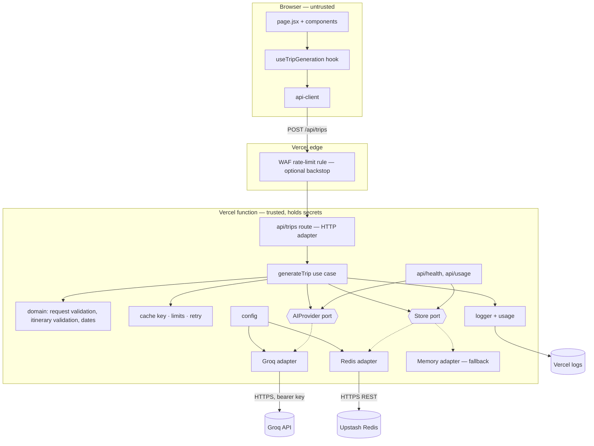
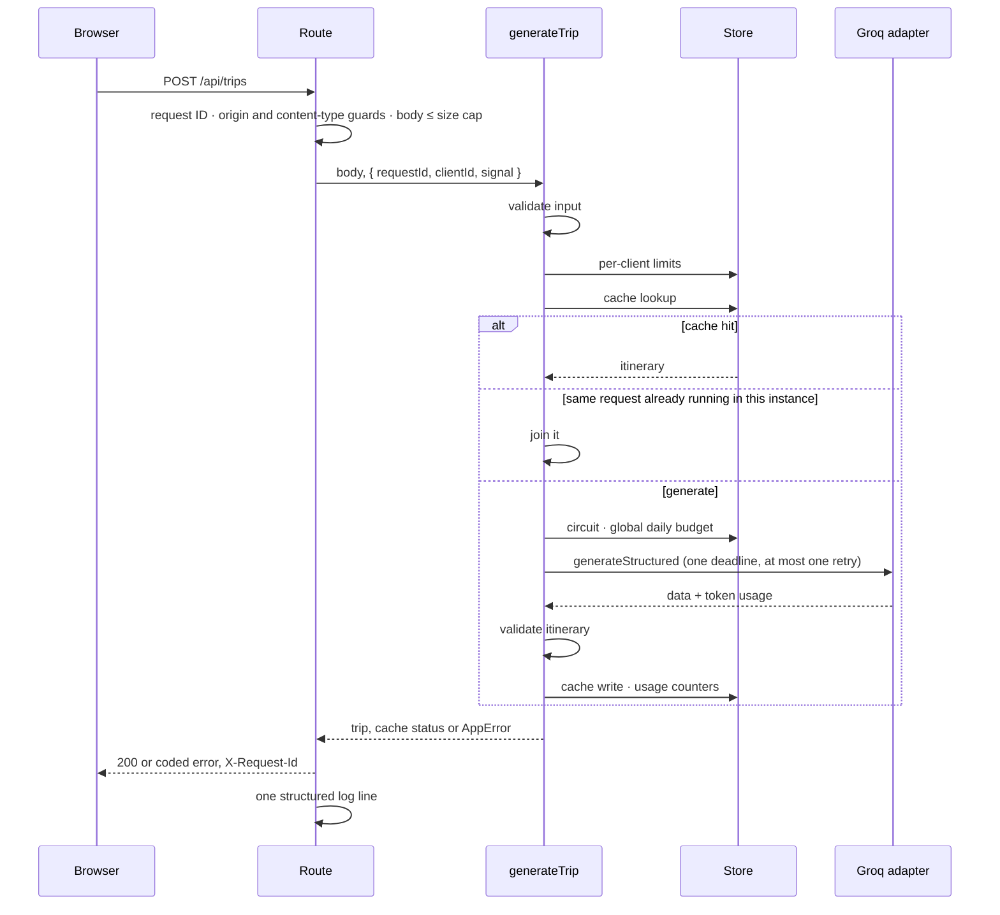
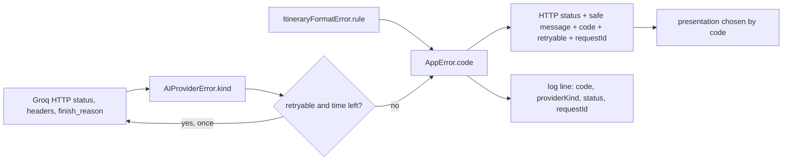

# High-Level Design — AI Travel Planner

- **Status:** Approved by the owner 2026-11-16 ("use your recommendations"). Implemented on branch `feat/groq-migration`; see `docs/engineering/PROJECT_STATUS.md` for what is verified.
- **Date:** 2026-11-15
- **Related:** [INITIAL_AUDIT.md](../engineering/INITIAL_AUDIT.md) (findings `F-xx`),
  [LLD.md](LLD.md) (interfaces and contracts), [MIGRATION_PLAN.md](../engineering/MIGRATION_PLAN.md).

How facts in this document were established:

- **Docs** — read on the provider's or platform's official documentation on 2026-11-15.
- **Measured** — observed on this repository or the live site during the audit.
- **Estimate** — arithmetic or judgement. Every estimate that affects a decision has a measurement
  scheduled in the migration plan.

---

## 1. Decisions that need approval

Five choices affect cost, infrastructure or behaviour. Each has a recommendation; the design works
with either answer except where stated.

| # | Decision | Recommendation | Alternative | Why it matters |
|---|---|---|---|---|
| D1 | Groq plan | **Decided 2026-11-16: Free plan, best available model.** | — | Live measurement (section 8.6) showed a 14-day itinerary is about 6,000 tokens, not the 10,000–12,000 first estimated, so it fits the free plan's 8,000 tokens per minute. The 14-day maximum is kept. The cost of the free plan is capacity: roughly one long itinerary per minute and 30 to 90 itineraries per day across all visitors |
| D2 | Shared store | **Decided 2026-11-16: Upstash Redis** through the Vercel Marketplace, free tier. Optional at runtime: without it the memory store is used | No store: one Vercel WAF rate-limit rule plus Vercel Runtime Cache | Only a store with atomic counters can enforce a global daily budget and produce a usage report. The alternative adds no vendor but gives up both |
| D3 | Cache lifetime | **Decided 2026-11-16: 24 hours** (`CACHE_TTL_SECONDS`) | 15 minutes | With a cache, submitting the same destination and dates again returns the same itinerary instead of a new variation. 24 hours also restores an itinerary lost to a page refresh |
| D4 | Version control for Claude Code files | **Decided 2026-11-16: track** `CLAUDE.md`, `.claude/agents/` and `.claude/skills/` in this repository | Leave them local | They are currently excluded by the global ignore file at `C:\Users\ASUS\.gitignore`, so they are not shared, reviewed or backed up |
| D5 | Browser test tool | **Decided 2026-11-16: Playwright**, as a development dependency | Manual browser checks only | The frontend scenarios cannot be automated without a browser; see LLD section 9 |

One confirmation is also needed (audit F-01): that the Google API key in the repository's public history
has been deleted in Google AI Studio.

---

## 2. System overview

A single Next.js application on Vercel. A visitor enters a name, dates and a destination. The server asks
an AI provider for a structured itinerary, validates it, and returns it. Nothing is stored permanently and
there are no accounts.

**Assumed scale:** up to a few hundred generations per day, bursts of a few per minute, one region. The
design is sized for that. Section 12 says what changes if it grows.

### What changes and what does not

| | Items |
|---|---|
| **Unchanged** | The user interface and its copy. The request body of `POST /api/trips`. The `trip` object the browser receives. Date handling. Shared form and server validation. The rule that the response's destination, dates and name come from the request. The rule that the name is never sent to the provider. Security headers. Vercel as host. No database, no accounts |
| **Refactored** | The route handler becomes a thin HTTP adapter over an application service. `lib/` is split into domain, application, infrastructure and HTTP layers. Configuration moves into one validated module. Submit logic moves from the page into a hook. Model-output validation becomes strict |
| **Replaced** | Gemini adapter → Groq adapter behind a provider contract. In-memory limiter → limiter on a shared-store port. Free-text errors → coded errors. `console.log` calls → structured log lines |
| **Added** | Response cache, in-flight de-duplication, global budgets, bounded retries, usage counters, request IDs, layered health checks, tests, lint, CI |

---

## 3. Architecture principles

1. **A modular monolith.** One deployable unit with enforced internal boundaries. Nothing here needs
   independent scaling or deployment, so separate services would add failure modes and no benefit.
2. **Dependencies point inwards.** Domain logic knows nothing about HTTP, the provider or the store.
3. **The provider is a detail.** Business logic calls a contract; one adapter implements it.
4. **Nothing from outside is trusted.** User input, model output and store contents are each validated
   at the boundary where they enter.
5. **Spend is controlled on the server.** The browser's cooldown is a courtesy, not a control.
6. **Optional infrastructure degrades, it does not fail.** A store outage reduces protection; it must not
   stop itineraries being generated.
7. **Every failure has a code, an honest message and a log line.**
8. **Nothing is added without a finding that requires it.**

---

## 4. Component diagram



The same code runs with no shared store configured: the Store port is then served by the memory adapter.
That is how it runs locally, in tests, and in production if the store is unreachable.

---

## 5. Evaluation of the current architecture

| Area | Today | Verdict | Proposed |
|---|---|---|---|
| Separation of concerns | Route holds guards, limits, orchestration and error mapping | Refactor | Thin route over a use case |
| Frontend and backend boundary | One fetch wrapper; no provider code in the browser | Keep | Unchanged |
| API design | Uncoded errors; no request ID | Refactor | Additive coded contract (LLD section 5) |
| AI provider integration | Imported directly by two routes | Replace | Provider port and Groq adapter |
| Domain logic | Sound, but mixed with prompt and Gemini schema in one file | Refactor | Split domain from prompt |
| Validation | Shared request validation is good; output validation has gaps | Tighten | LLD section 3 |
| Error propagation | One provider error kind covers two conditions (F-07) | Refactor | Provider kinds → application codes |
| Rate limiting | Per instance, in memory | Replace | Shared store with memory fallback |
| Caching | None | Add | Content-addressed response cache |
| Concurrency control | None | Add | In-flight joining; the provider's own per-minute admission check (section 8.5) |
| Request lifecycle | Linear, no retry, no deadline shared across attempts | Refactor | One deadline; bounded retry |
| Scalability | Adequate for the function; unprotected provider quota | Add | Budgets and circuit |
| Reliability | One transient error fails the request | Improve | One retry for transient failures |
| Security | Good baseline | Keep, extend | Body cap, strict output validation, log hygiene |
| Observability | Unstructured logs, no IDs, no token counts | Replace | Structured logs, usage counters |
| Deployment | Vercel, ungated | Keep, gate | CI and branch protection |

---

## 6. Backend architecture

Four layers; the folder layout and every contract are in the LLD.

| Layer | Contains | May depend on |
|---|---|---|
| Presentation | Route handlers, React components | HTTP helpers, client, domain |
| Application | `generateTrip`, prompt, cache key, limits, retry, error types | Domain, and ports it defines |
| Domain | Request validation, itinerary validation, dates, error codes | Nothing |
| Infrastructure | Config, Groq adapter, store adapters, logger, composition root | Application, domain |

Dependencies are passed in explicitly (`createGenerateTrip({ provider, store, logger, config, now, random,
sleep })`). This is the only form of dependency injection proposed: it is what lets the use case be tested
with a scripted provider and a controllable clock.

### Request lifecycle



---

## 7. Frontend architecture

- Components stay presentational. `page.jsx` composes them.
- A `useTripGeneration` hook owns the submit state machine, cooldown and cancellation (LLD section 8).
- The API client returns a typed error carrying `code`, `retryable` and `retryAfterSeconds`.
- A `GenerationStatus` component picks the presentation from the code, so "come back later" and "try again
  in 20 seconds" are no longer the same red banner.
- No state library is proposed. There is one screen with one request.
- `page.jsx` is a server component; `Planner.jsx` is the one client island for the request flow, plus the
  nav and the day navigator. Static sections ship no JavaScript.
- Visual design (redesign, 2026-11): `docs/design/DESIGN_SYSTEM.md` and `docs/design/UX_RESEARCH.md`. No new
  dependency: the Manrope font comes through `next/font` (self-hosted, CSP `font-src 'self'`) and replaces
  Geist; icons are inline SVG.

---

## 8. AI integration architecture

### 8.1 Provider facts (Docs, console.groq.com, 2026-11-15)

**Models available on the Free and Developer plans**

| Model | Status | Context | Max output | Speed (published) | Price per million tokens | Strict JSON schema |
|---|---|---|---|---|---|---|
| `openai/gpt-oss-120b` | Production | 131,072 | 65,536 | about 500 tokens/s | $0.15 in, $0.60 out | Yes |
| `openai/gpt-oss-20b` | Production | 131,072 | 65,536 | about 1,000 tokens/s | $0.075 in, $0.30 out | Yes |
| `qwen/qwen3.8-27b` | Preview | 131,072 | 16,384 | about 450 tokens/s | $0.80 in, $4.00 out | Listed, with an inconsistency on the page |

`llama-3.3-70b-versatile` and `llama-3.1-8b-instant` were withdrawn from the Free and Developer plans on
16 August 2026 and are now Enterprise only. Most tutorials, and some of Groq's own examples, still use
them. They must not be used here.

**Rate limits, per organisation**

| Plan | Requests/min | Requests/day | Tokens/min | Tokens/day |
|---|---|---|---|---|
| Free | 30 | 1,000 | 8,000 | 200,000 |
| Developer | 1,000 | 500,000 | 250,000 | No limit listed |

These are the values for both GPT-OSS models. They are configuration inputs, not constants: the
application's budgets are environment variables set below whatever the account's current limits are.

**Other facts that shape the design**

| Fact | Consequence |
|---|---|
| Strict mode requires every property in `required` and `additionalProperties: false` on every object. The documentation says it "never produces invalid JSON" | The schema is written in that subset. **The guarantee did not hold when measured** (section 8.6): 2 of 10 generations were rejected by Groq with a schema error after generation, so invalid output is treated as a normal, expected failure |
| Array-length keywords are not documented as supported | Day and activity counts stay in the prompt and are enforced by `validateItinerary` |
| Streaming is not supported with structured outputs | One blocking call per generation; no progressive display |
| GPT-OSS models always reason. `reasoning_effort` accepts `low`, `medium`, `high`; `include_reasoning: false` hides the reasoning text | Send `low` and `false`. Whether reasoning tokens count towards the output cap is not documented, so the cap is set from measurements |
| The default output cap is 1,024 tokens | `max_completion_tokens` is always set explicitly |
| Error bodies are `{ "error": { "message", "type" } }`. The documentation lists no error codes | Measured bodies also carry `code`: `rate_limit_exceeded` and `json_validate_failed` (section 8.6). The adapter classifies by HTTP status first and uses `code` only to refine, so an undocumented change degrades to a safe default. Provider messages contain the organisation ID and are never logged or shown |
| A 429 carries `retry-after` in seconds. `x-ratelimit-*-requests` describes the daily request limit; `x-ratelimit-*-tokens` describes the per-minute token limit | Used to separate a short wait from an exhausted day |
| Requests that return server errors are not charged | A retry after a 5xx costs latency, not money |
| No fixed deprecation notice period. Observed notice has ranged from about three weeks to two months. Preview models can be withdrawn at short notice | The model ID is configuration with no default in code. Only production models are used |
| Official SDK `groq-sdk` 1.6.0: no runtime dependencies, Node 20+, default timeout 60 s, **default of 2 automatic retries** that honour `retry-after` with no upper bound | Use the SDK with `maxRetries: 0` and an explicit timeout. The application's own retry policy is the only one |

### 8.2 Model selection

**Selected: `openai/gpt-oss-120b`.** It is the best model the free plan offers for this workload.

- Both GPT-OSS models are production models with the same free-plan limits and an output limit ten times
  larger than the longest itinerary. They are the only production chat models this key can call
  (Measured, `GET /models`).
- Measured (section 8.6): the 120b model returned a usable itinerary in 6 of 7 generations. The 20b model
  did so in 1 of 3: one schema error, and one response that contained a single day when fourteen were
  requested. The samples are small, but the 20b failures are of a worse kind.
- The 20b model is faster (7 s against 11–13 s for 14 days). At these durations that does not matter.
- The model is one environment variable, so changing it later is not a code change.
- No automatic fallback between models is proposed. It would be a second code path that only runs during
  an outage, which is the hardest kind to keep correct.

### 8.3 Provider contract

```
AIProvider
  name, model
  generateStructured({ system, prompt, schemaName, schema, maxOutputTokens, timeoutMs, signal })
      → { data, usage: { inputTokens, outputTokens }, provider, model, latencyMs }
      throws AIProviderError(kind, …)
  checkAvailability({ signal })     verifies key and model without generating tokens
```

The contract is as small as the application needs. It supports structured generation, model
identification, a timeout, cancellation, reported token usage and normalised errors. It has no streaming,
tool calls or chat history, because nothing uses them.

**Only one adapter is built.** A second provider would be written when one is needed. The plan was to move
the Gemini code behind the contract first. That step was skipped: the contract was proven instead by the
adapter's tests against measured Groq responses and by real generations through the full stack. The Gemini
code was deleted; rollback is by promoting the previous Vercel deployment (DEPLOYMENT.md section 4).

### 8.4 Groq response → provider error kind

| Groq response | `AIProviderError.kind` | Retried |
|---|---|---|
| Key not configured | `not_configured` | No |
| 401, 403 | `auth` | No |
| 404 | `model_not_found` | No |
| 400 with `code: json_validate_failed` | `invalid_output`, after first trying to recover the itinerary from `failed_generation` (see below) | Once |
| Any other 400 | `invalid_request` | No |
| 413 | `context_length` | No |
| 422 | `invalid_output` | Once |
| 429 naming a per-minute limit, or with `retry-after` up to 60 s | `rate_limited` | Once, after waiting `retry-after`, if it fits the deadline |
| 429 naming a per-day limit, or with `retry-after` over 60 s, or `x-ratelimit-remaining-requests: 0` | `quota_exhausted` | No |
| 498, 500, 502, 503 | `unavailable` | Once |
| No response | `connection` | Once |
| Our deadline passed | `timeout` | No |
| Caller cancelled | `aborted` | No |
| `finish_reason: "length"` | `truncated` | No |
| `message.refusal` present | `refused` | No |
| Empty content, or content that is not JSON | `invalid_output` | Once |

**The per-minute 429 is Measured.** The body is `{ "error": { "type": "tokens", "code":
"rate_limit_exceeded", "message": "… on tokens per minute (TPM): Limit 8000, Used 3720, Requested 6159.
Please try again in 14.09s …" } }` with `retry-after: 15`. It is returned in about 250 ms, before any
generation, and does not count against the daily request limit.

**The per-day 429 has not been observed**, because reaching it would spend the day's quota. The adapter
therefore recognises it three ways: the message naming a per-day limit, a `retry-after` longer than 60
seconds, or the daily-requests header at zero. If none matches, the 429 is treated as `rate_limited`, which
at worst costs one wasted wait before the user is told to try later.

**Recovering a rejected generation.** When Groq rejects output for a schema error, the complete generated
text is returned in `error.failed_generation` (Measured). In both observed cases one field in one activity
was wrong and the rest of the itinerary was intact. The adapter parses that text and hands it to
`validateItinerary`, whose repair rules drop the bad activity and keep the trip. Only if that also fails is
the request retried. This matters on the free plan: the rejected generation has already been charged
against the per-minute allowance, so a blind retry would usually have to wait for it to refill.
`failed_generation` is undocumented, so its absence simply falls through to the retry.

How these kinds become user-facing codes and HTTP statuses is in LLD section 4.7.

### 8.5 Generation strategy

Sizes and durations are Measured on `openai/gpt-oss-120b` (section 8.6): 1,250 tokens and 2 seconds for
one day, 5,800–6,700 tokens and 11–13 seconds for fourteen.

| | A. Single request | B. Chunked by date range | C. Background job | D. Generate each day on demand |
|---|---|---|---|---|
| Latency, 14 days | 11–13 s (Measured) | No faster on the free plan: the second chunk would wait for the per-minute allowance | Same work; the user polls | Fast first paint; slow overall |
| Tokens | Baseline | Slightly more: instructions repeat per chunk | Baseline | Much more: instructions repeat per day |
| Requests per trip | 1 | 2 or more | 1 | Up to 14 |
| Reliability | One failure loses the whole trip | A failed chunk can be retried alone | Survives a closed tab | Per-day failures |
| Quality | One coherent plan | Chunks cannot see each other, so restaurants and sights repeat unless chunks run in sequence, which removes the latency gain | Same as A | Same problem as B, worse |
| Complexity | Lowest | Merge logic, partial-failure handling, ownership of title, notes and budget | Durable job store, status endpoint, polling, cleanup | New UI and API |
| Fit with Vercel limits | Within the 60 s the route already sets | Comfortable | Needs storage that does not exist | Fine |
| User experience | Unchanged | Unchanged | Changed | Changed |

**Decision: A, with the response cache.** The longest trip fits one request on the free plan with about
20 percent of the per-minute allowance to spare, completes in 13 seconds against a 50-second deadline, and
keeps the plan coherent. Chunking would add requests and waiting without solving anything.

C is not justified at these durations. The rule for revisiting A: if more than 1 in 20 long itineraries is
still unusable after recovery and one retry, generate long trips in two sequential halves.

**What the free plan costs.** The limits are per organisation and per model, so every visitor shares them.

| Limit (free plan, per model) | Measured consumption | Capacity |
|---|---|---|
| 8,000 tokens per minute | 1,250 (1 day), 2,200 (3 days), 3,700 (7 days), 4,800 (10 days), 5,800–6,700 (14 days) | About one 14-day trip, or two 7-day trips, or six 1-day trips per minute |
| 200,000 tokens per day | The same | About 30 fourteen-day trips, or 90 three-day trips, or 160 one-day trips per day |
| 1,000 requests per day | 1 per trip | Not the binding limit |
| 30 requests per minute | 1 per trip | Not the binding limit |

**Behaviour under contention.** A request that would exceed the per-minute allowance is refused by Groq in
about a quarter of a second, at no cost, with the number of seconds to wait (Measured: 14–15 s after a
long trip). The use case waits that long and tries once more, inside the same 50-second deadline. A second
visitor arriving just after a long generation therefore waits roughly 15 seconds longer instead of seeing
an error. A third arriving in the same minute may be told the service is busy and given a countdown.

Because Groq does this admission check itself, quickly and for free, the application does not duplicate
it. The global per-minute counter in the earlier draft is removed. The application keeps a daily token
budget, because the provider's daily refusal is the one that cannot be waited out.

**Content quality on long trips** (Measured, one destination): the 14-day itineraries reuse the same
handful of restaurants on several days and give street addresses that look invented. This is a prompt
and expectations issue rather than an architecture issue. It is addressed in milestone 6 by telling the
model not to repeat a venue and to give the venue name and area without a street number, and it is why
the "AI-generated, not verified" notice stays prominent.

### 8.6 Live measurements

Taken 2026-11-16 with the owner's free-plan key, using the application's current system instruction,
prompt and schema (strict mode, `reasoning_effort: low`, `include_reasoning: false`), one destination.
Thirteen requests were sent: ten produced a generation, and three were deliberately sent back to back to
capture the rate-limit refusal.

| Model | Days | Result | Time | Input tokens | Output tokens | Of which reasoning | Total |
|---|---|---|---|---|---|---|---|
| 120b | 1 | Valid | 1.9 s | 575 | 676 | 80 | 1,251 |
| 120b | 3 | Valid | 3.6 s | 591 | 1,599 | 116 | 2,190 |
| 120b | 7 | Valid | 6.7 s | 623 | 3,058 | 46 | 3,681 |
| 120b | 10 | Valid | 8.9 s | 647 | 4,133 | 44 | 4,780 |
| 120b | 10 | Valid | 9.4 s | 647 | 4,259 | 52 | 4,906 |
| 120b | 14 | **Rejected by Groq: schema error** (a misspelt key in one activity) | 12.6 s | — | — | — | about 6,700 |
| 120b | 14 | Valid | 11.2 s | 679 | 5,097 | 42 | 5,776 |
| 20b | 14 | Valid | 7.4 s | 679 | 5,480 | 35 | 6,159 |
| 20b | 7 | **Rejected by Groq: schema error** (a missing field) | 2.6 s | — | — | — | — |
| 20b | 14 | **Unusable: one day returned instead of fourteen** | 4.7 s | — | — | — | 4,354 |
| 20b | 14 ×3, back to back | Refused, 429, `retry-after` 14–15 s | 0.25 s | — | — | — | 0 |

What these establish:

- A day costs about 600 output tokens in a short trip and about 370 in a long one; the model writes more
  tersely as the trip grows. Input is 575–680 tokens including the schema.
- Reasoning at `low` costs 35–116 tokens. It is not a budgeting concern.
- `max_completion_tokens` is not charged at admission: requests asking for up to 15,500 were admitted
  against an 8,000 allowance. The output cap is therefore set as a safety limit only:
  1,000 plus 600 per day.
- The allowance refills continuously, at about 133 tokens per second, rather than resetting each minute.
- Each model has its own counters.
- Every usable response had exactly five activities per day with correctly formatted times.

What they do not establish: failure rates (the samples are far too small), behaviour for other
destinations and languages, and the per-day 429. The usage counters in milestone 8 will measure the first
two in production.

---

## 9. Quota protection

Layers, from the outside in. Each stops a different kind of waste.

| Layer | Stops | Where |
|---|---|---|
| WAF rate-limit rule (optional) | Floods, before a function is invoked | Vercel edge |
| Origin and content-type guard | Other websites' pages spending the quota from a visitor's browser | Route |
| Body size cap | Oversized payloads | Route |
| Input validation | Requests that could never succeed | Use case |
| Per-client limits, per minute and per day | One client taking a large share | Shared store |
| Response cache | Regenerating an identical request | Shared store |
| In-flight joining | Double clicks, two tabs, concurrent identical requests | Instance memory |
| Provider circuit | Calling a provider that has just said the quota is gone | Shared store |
| Global daily token budget | Many clients together exhausting the provider's daily allowance | Shared store |
| Provider's own per-minute admission check | Exceeding the per-minute allowance. Refused in about 250 ms at no cost | Groq |
| Output-token cap scaled to trip length | Runaway responses | Provider request |
| Recovery of rejected generations | Paying twice for an itinerary with one bad field | Provider adapter |
| Bounded retry that honours `retry-after` | Retry storms and multiplied spend | Use case |

### Shared store

| | Memory only (today) | WAF rule + Runtime Cache | **Upstash Redis** |
|---|---|---|---|
| Global per-client limit | No | Yes, per region, windows of 10 s to 10 min | Yes |
| Per-client daily limit | No | No | Yes |
| Global daily budget | No | No | Yes |
| Response cache | No | Yes, regional, may be evicted | Yes |
| Usage counters | No | No | Yes |
| Defined in the repository and testable locally | Yes | The WAF rule lives in the dashboard and does nothing locally | Yes, with the memory adapter standing in |
| New runtime dependencies | 0 | 1 (`@vercel/functions`) | 1 (`@upstash/redis`) |
| Cost at the assumed scale | $0 | $0 | $0: about 70,000 commands a month against 500,000 included (Estimate: 300 requests a day, 8 commands each) |
| New vendor | No | No | Yes |

Facts in this table are from Vercel's and Upstash's documentation. Vercel KV no longer exists; Vercel
directs new projects to a Marketplace Redis integration. Vercel Runtime Cache has no atomic increment and
Vercel's configuration store allows about 100 writes a month on the Hobby plan, so neither can hold
counters.

**Recommendation: Upstash Redis behind the Store port, with the memory adapter as fallback.** It is the
only option that satisfies the budget and usage-reporting requirements, it does so with one adapter, and
the application runs without it. The WAF rule is worth adding as well: it takes minutes, costs nothing,
and rejects floods before they reach the function.

`@upstash/ratelimit` is not proposed. A fixed window on an atomic increment is about fifteen lines on the
Store port, and using the port keeps the memory adapter and the tests on the same code path.

### Behaviour when the store fails

| Operation | On store error or timeout (1 s) |
|---|---|
| Rate-limit counters | Fall back to the memory adapter for that request. Protection drops to today's level, per instance |
| Budget counters | Same fallback |
| Circuit read | Read from the memory fallback (closed unless this instance opened it) |
| Cache read | Treated as a miss |
| Cache write, usage counters | Written to the memory fallback |
| Health | Reports `store: degraded` |

Every fallback is logged as `store_degraded`. No store failure produces a user-visible error.

---

## 10. Error handling flow



- Provider messages never reach the user. They are replaced by a fixed message per code.
- Provider detail reaches the log as a kind and a status, never as free text.
- The user-facing 429 is reserved for the client's own request rate. Provider limits surface as 503 with
  a different code and wording (fixes F-07).

---

## 11. Security boundaries

| Boundary | Crossing it | Control |
|---|---|---|
| Browser → function | Destination, dates, name | Size cap, validation, per-client limits, origin guard |
| Function → Groq | Destination and dates only | Name never sent. Destination JSON-quoted. Key in a header, read in one module |
| Groq → function | Model output | Constrained to a schema by the provider, then validated independently; rebuilt field by field |
| Function → store | Hashed client identifiers, counters, cached itineraries | No name, no raw IP, no key. Everything expires |
| Function → browser | The trip | Authoritative fields from the request. Rendered as text |
| Function → logs | Metadata | No destination, name, key, headers or model output; asserted by a test |

Two points deserve stating plainly:

- **The system instruction is not a defence against prompt injection.** It lowers the chance of a derailed
  response. The actual controls are that the model can only emit the schema's fields, that every field is
  length-limited and rendered as plain text, and that nothing in the response is trusted for identity,
  dates or routing.
- **A cache makes model output shared between users.** Today a visitor only ever sees output produced
  from their own input. With a cache, two visitors who type the same destination and dates see the same
  stored output. The cache key is the full normalised destination string, so one visitor cannot plant
  content under another's ordinary request, and the stored value has passed validation. This is recorded
  for the security audit to test rather than assume.

The full review is a later deliverable (`docs/engineering/SECURITY_AUDIT.md`).

---

## 12. Infrastructure requirements

| Item | Needed? | Notes |
|---|---|---|
| Vercel project | Yes, exists | No change of platform |
| Groq account and API key | **Yes, in place** | Free plan. No cost. Moving to the Developer plan later needs no code change, only larger budget values |
| Upstash Redis | Recommended (D2) | The application runs without it, with weaker protection |
| Vercel WAF rate-limit rule | Optional | One rule is included on the Hobby plan |
| GitHub Actions | Yes | CI. Free for a public repository |
| Database, queue, object storage, authentication | **No** | No requirement needs them |

**Vercel settings to confirm in the dashboard** (they cannot be read from the repository):

- Whether Fluid Compute is enabled. With it, the function limit on the Hobby plan is 300 s and the
  explicit 60 s in the route is well inside it (Docs). The live site already completes 30-second
  generations (Claimed), so the current setting is workable either way.
- That `main` is the production branch and that pull requests get preview deployments.

---

## 13. Scalability strategy

| If | Then |
|---|---|
| Traffic grows within one region | Nothing changes. Functions scale out; the shared store keeps limits and cache correct across instances. Raise the budgets |
| Duplicate generations appear across instances | Add a short-lived lock in the store keyed by the cache key |
| The provider's per-minute token limit becomes the constraint | Raise the Groq plan, or queue with a visible wait. Not before it is measured |
| Long itineraries breach the latency rule in section 8.5 | Move to sequential chunking |
| Trips need to be saved or shared | That is a product feature needing a database and probably identity. Out of scope |

The first real bottleneck is the provider's quota and cost, not compute. That is why the design spends its
effort on budgets, caching and de-duplication rather than on infrastructure.

---

## 14. Trade-offs

| Choice | Gained | Given up |
|---|---|---|
| Modular monolith | One deployment, simple operations | Independent scaling, which is not needed |
| Single-request generation | Coherent itineraries, least code | A failure loses the whole trip; mitigated by one retry |
| No streaming | Strict structured output | Progress display during the wait |
| Strict validation that rejects | No malformed itinerary reaches a user | A slightly higher failure rate; mitigated by one retry on invalid output |
| Cache keyed on exact dates | Correct weekday-specific advice | A lower hit rate than a coarser key |
| 24-hour cache | Refresh and repeat requests cost nothing | Identical inputs return an identical itinerary for a day |
| Fixed-window counters | Simplicity, one increment per check | Up to twice the limit across a window boundary |
| Relying on the provider's per-minute admission check instead of an application counter or concurrency leases | No duplicated limit, no leaked leases when a function is killed; a refusal costs nothing | A visitor can wait up to about 15 s for the allowance to refill before being told the service is busy |
| Store failures degrade to memory | Availability | Weaker limits during an outage |
| Additive API contract | No breakage during deployments | A less uniform envelope than a redesign would give |
| Hand-written validation | No dependency in the browser bundle; explicit repair rules | More code to test |
| Staying in JavaScript | A smaller migration | Compile-time type checking |
| One provider adapter | No speculative code | A second provider is future work |
