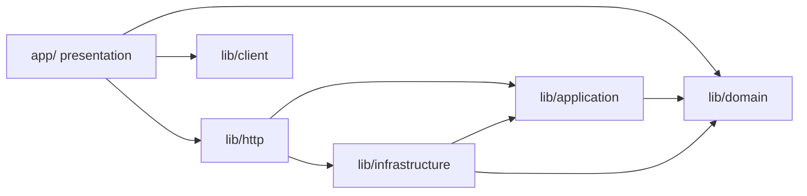
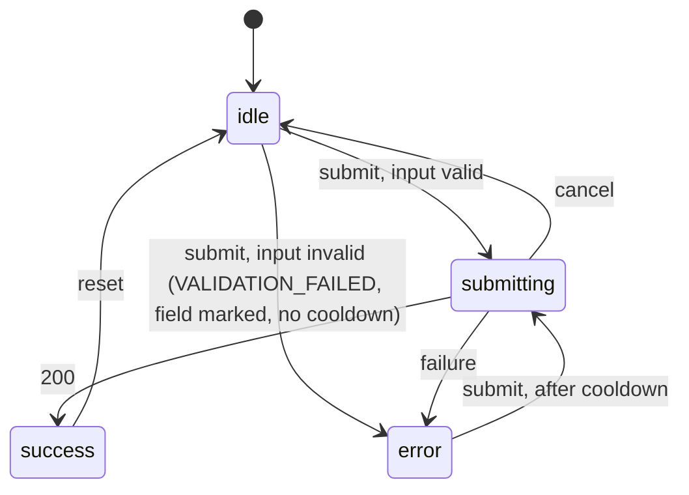

# Low-Level Design — AI Travel Planner

- **Status:** Approved by the owner 2026-11-16 ("use your recommendations"). Implemented on branch `feat/groq-migration`; see `docs/engineering/PROJECT_STATUS.md` for what is verified.
- **Date:** 2026-11-15
- **Read first:** [HLD.md](HLD.md) for the reasoning behind these choices, and
  [INITIAL_AUDIT.md](../engineering/INITIAL_AUDIT.md) for the findings (`F-xx`) each part addresses.

---

## 1. Directory structure

```
app/                                 PRESENTATION
├── layout.js                        Manrope via next/font, metadata
├── page.jsx                         server component: nav, hero, planner island, "How it works", footer
├── not-found.jsx                    designed 404 (server component)
├── globals.css                      design tokens (Tailwind 4 @theme), base styles, hero and nav CSS
├── components/
│   ├── Planner.jsx                  the one client island: form state, status, result, focus management
│   ├── TripForm.jsx                 the form (Where / When / Who), field errors, live day count
│   ├── GenerationStatus.jsx         ErrorBanner (chosen by error code) and LoadingPanel (skeleton, Cancel)
│   ├── ItineraryView.jsx            the plan: title, AI notice, summary, notes, day timeline
│   ├── DayNav.jsx                   day navigator: sticky chip row (mobile) / side list (lg), client
│   ├── result-layout.js             grid and date formatters shared by the result and its skeleton
│   ├── SiteNav.jsx                  sticky nav, condenses after the hero (client)
│   ├── Hero.jsx, InfoSections.jsx, SiteFooter.jsx   static (server components)
│   ├── icons.jsx                    inline SVG icons (Lucide paths, ISC)
│   └── brand.js                     product name
├── hooks/
│   └── useTripGeneration.js         submit state machine: idle → submitting → success | error; cooldown; abort
└── api/
    ├── trips/route.js               HTTP adapter only (about 30 lines)
    ├── health/route.js              liveness and configuration; optional protected provider probe
    └── usage/route.js               protected usage report

lib/
├── domain/                          PURE. No I/O, no environment, no Next.js. Runs in browser and server
│   ├── dates.js                     moved unchanged
│   ├── trip-request.js              parseTripRequest and the input limits
│   ├── itinerary.js                 validateItinerary (model output → Trip), ItineraryFormatError
│   ├── text.js                      cleanText / clip: whitespace, control and invisible characters
│   └── error-codes.js               the error-code table shared by server and browser
│
├── application/                     USE CASES. Server-side. Depends on domain and on ports, never on adapters
│   ├── generate-trip.js             createGenerateTrip(deps) → generateTrip(input, context)
│   ├── itinerary-prompt.js          system instruction, prompt builder, JSON Schema, PROMPT_VERSION
│   ├── cache-key.js                 tripCacheKey(request, model)
│   ├── retry.js                     withRetry(operation, policy)
│   ├── limits.js                    rate-limit and budget rules built on the Store port
│   └── errors.js                    AppError, AIProviderError
│
├── infrastructure/                  ADAPTERS. Server-only
│   ├── config.js                    reads and validates the environment once
│   ├── container.js                 composition root: builds and memoises the dependencies
│   ├── logger.js                    one JSON line per event
│   ├── ai/
│   │   └── groq-provider.js         implements the AIProvider port (container.js selects it)
│   └── store/
│       ├── memory-store.js          implements the Store port in process memory
│       ├── redis-store.js           implements the Store port on the shared store
│       └── resilient-store.js       wraps a primary store with a timeout and the memory fallback
│
├── http/                            ROUTE HELPERS. Server-only
│   ├── request.js                   request ID, client identity (IPv6 grouped by /64), origin and
│   │                                content-type guards, size-capped body reader, admin-token check
│   └── respond.js                   success and error responses; AppError → HTTP status
│
└── client/
    └── api-client.js                browser fetch wrapper; throws TripRequestError with a code

test/
├── domain/                          pure unit tests
├── application/                     use-case tests with fake provider and memory store
├── infrastructure/                  provider adapter tests with a stubbed fetch; store tests
├── http/                            route tests: real handler, injected container
├── client/                          browser API client
├── fixtures.js                      fakes, sample output, buildUseCase() with a controllable clock
└── e2e/                             browser tests with the API mocked at the network layer

scripts/
└── smoke-ai.mjs                     manual, explicit real-provider check; never run by `npm test`
```

### Dependency rule



- `domain` imports nothing outside `domain`.
- `application` imports `domain` only. It receives adapters as arguments.
- `infrastructure` implements the ports that `application` defines.
- Only `infrastructure/container.js` knows which adapters are in use. Only `infrastructure/config.js`
  reads `process.env`.
- Browser code may import `lib/domain` and `lib/client`, nothing else. `infrastructure` and `http` begin
  with `import 'server-only'`, so a wrong import fails the build.

An ESLint `no-restricted-imports` rule enforces these directions, so the boundaries are checked rather
than relied on.

### Where today's code goes

| Today | Proposed | Change |
|---|---|---|
| `lib/dates.js` | `lib/domain/dates.js` | Move only |
| `lib/itinerary.js` `parseTripRequest`, limits | `lib/domain/trip-request.js` | Move; add a latest-start-date rule (F-25) |
| `lib/itinerary.js` `parseModelJson`, `normalizeItinerary` | `lib/domain/itinerary.js` | Tighten (F-10). JSON parsing moves into the provider adapter |
| `lib/itinerary.js` prompt and schema | `lib/application/itinerary-prompt.js` | Schema rewritten as provider-neutral JSON Schema; add `PROMPT_VERSION` |
| `lib/gemini.js` | `lib/infrastructure/ai/groq-provider.js` | Replaced. `AIServiceError` becomes `AIProviderError` in `application/errors.js`. The Gemini code was deleted rather than first moved behind the port: Groq was proven directly against the port's tests and with real requests. Rollback is by promoting the previous Vercel deployment |
| `lib/rate-limit.js` | `lib/application/limits.js` and `lib/infrastructure/store/memory-store.js` | Same algorithm, now on the Store port |
| `lib/api-client.js` | `lib/client/api-client.js` | Reads `code`, `retryable` |
| `app/api/trips/route.js` | route (HTTP only) and `lib/application/generate-trip.js` | Split (F-08) |
| `app/page.jsx` submit logic | `app/hooks/useTripGeneration.js` | Extracted |

---

## 2. Data models

Plain objects described with JSDoc typedefs. There is no TypeScript in this project and none is proposed.

```js
/** @typedef {Object} TripRequest          Validated user input. Authoritative for these fields.
 *  @property {string}   destination       cleaned, 1–150 characters
 *  @property {string}   createdBy         cleaned, 1–80 characters. Never sent to the provider, logged or cached
 *  @property {string}   startDate         "YYYY-MM-DD"
 *  @property {string}   endDate           "YYYY-MM-DD"
 *  @property {string[]} dates             every calendar day of the trip, in order, 1–14 entries
 */

/** @typedef {Object} Activity
 *  @property {string} time                "HH:MM", 24-hour
 *  @property {string} title               1–120 characters
 *  @property {string} description         0–600 characters
 *  @property {string} location            0–200 characters
 *  @property {string} notes               0–400 characters
 */

/** @typedef {Object} TripDay
 *  @property {number}     day             1-based, assigned by the server
 *  @property {string}     date            from TripRequest.dates, never from the model
 *  @property {string}     location        0–120 characters
 *  @property {Activity[]} activities      3–8 entries, in chronological order
 */

/** @typedef {Object} GeneratedItinerary   What is cached. Contains no personal data.
 *  @property {string}       title
 *  @property {string}       notes
 *  @property {{currency: string, estimated: number} | null} budget
 *  @property {TripDay[]}    days
 *  @property {string}       generatedAt   ISO timestamp of the original generation
 */

/** @typedef {GeneratedItinerary & {destination: string, startDate: string, endDate: string, createdBy: string}} Trip
 *  What the browser receives. Same shape as today's `trip`.
 */
```

---

## 3. Domain contracts (`lib/domain`)

### `parseTripRequest(body, { minStartDate, maxStartDate }) → { ok: true, value: TripRequest } | { ok: false, error: string, field: string }`

Unchanged behaviour, with two additions: the failing `field` is returned so the form can mark it, and
`maxStartDate` rejects trips starting more than two years ahead.

### `validateItinerary(raw, request) → GeneratedItinerary`

Throws `ItineraryFormatError(message, { rule })`. Each rule is one of **reject** (throw; the use case may
retry once) or **repair** (fix deterministically and continue). The choice is deliberate: reject when the
content is wrong, repair when only its form is wrong.

| Rule | Check | On failure |
|---|---|---|
| `shape` | `raw` is an object with a `days` array | Reject |
| `day_count` | `days.length` equals the requested day count | Reject. Today, extra days are silently dropped |
| `day_date` | Where the model supplied `date`, it equals the requested date for that position | Reject. Today this is not checked |
| `day_shape` | Each day is an object with an `activities` array | Reject |
| `activity_title` | Title is non-empty after cleaning | Drop that activity |
| `activity_time` | Matches `HH:MM`, 24-hour | Repair `8:00` → `08:00`; otherwise drop that activity. Today free text is kept |
| `activity_count` | 3–8 valid activities remain in the day | Fewer than 3: reject. More than 8: keep the first 8 |
| `activity_order` | Times ascend within the day | Repair by stable sort |
| `text_length` | Every string is within its limit | Repair by truncation at the limit |
| `text_content` | Control, zero-width and bidirectional-override characters | Repair by removal |
| `budget` | `estimated` is a positive finite number; `currency` is three letters and accepted by `Intl.NumberFormat` | Repair to `null`; the UI already hides a missing budget |
| `unexpected_fields` | Any field not in the model | Dropped: the output is rebuilt field by field, never spread |
| Authoritative fields | `destination`, `startDate`, `endDate`, `createdBy`, `day`, `date` | Never read from the model |

**No validation library is proposed.** There are two small fixed shapes; the rules above mix rejection with
repair, which schema libraries express awkwardly; and `lib/domain` is bundled into the browser, where a
library would add weight to every page load. The trade-off is that the rules are hand-written, which is why
each one gets its own test.

---

## 4. Application contracts (`lib/application`)

### 4.1 Ports

These are the only things the use case knows about the outside world.

```js
/** @typedef {Object} AIProvider
 *  @property {string} name                                   e.g. "groq"
 *  @property {string} model                                  the configured model ID
 *  @property {(req: StructuredRequest) => Promise<StructuredResult>} generateStructured
 *  @property {(opts: {signal?: AbortSignal}) => Promise<void>} checkAvailability
 *            Verifies credentials and model without generating tokens. Throws AIProviderError.
 */

/** @typedef {Object} StructuredRequest
 *  @property {string}      system
 *  @property {string}      prompt
 *  @property {string}      schemaName
 *  @property {object}      schema            JSON Schema; see 4.3
 *  @property {number}      maxOutputTokens
 *  @property {number}      timeoutMs
 *  @property {AbortSignal} [signal]          the caller's cancellation
 */

/** @typedef {Object} StructuredResult
 *  @property {unknown} data                  parsed JSON. Not yet validated against domain rules
 *  @property {{inputTokens: number|null, outputTokens: number|null}} usage   provider-reported; null if absent
 *  @property {string}  provider
 *  @property {string}  model                 the model the provider says it used
 *  @property {number}  latencyMs
 */

/** @typedef {Object} Store                   A minimal shared key-value port
 *  @property {(key: string) => Promise<string|null>} get
 *  @property {(key: string, value: string, opts: {ttlSeconds: number}) => Promise<void>} set
 *  @property {(key: string, opts: {ttlSeconds: number, by?: number}) => Promise<number>} incr
 *            Atomic. The TTL is set only when the key is created.
 *  @property {() => Promise<void>} ping
 */

/** @typedef {Object} Logger
 *  @property {(event: string, fields?: object) => void} info
 *  @property {(event: string, fields?: object) => void} warn
 *  @property {(event: string, fields?: object) => void} error
 */
```

One `Store` port carries rate limiting, the daily budget, the cache and the usage counters. That is one
adapter to write and one thing to fake in tests, instead of four.

### 4.2 `createGenerateTrip(deps) → generateTrip(input, context)`

```js
deps    = { provider, store, logger, config, now = Date.now, random = Math.random, sleep }
input   = unknown                      // the parsed JSON body
context = { requestId, clientId, signal }
returns = { trip: Trip, cache: 'hit' | 'miss' | 'joined' }
throws  = AppError
```

`now`, `random` and `sleep` are injected so that expiry, jitter and back-off are deterministic in tests.

Steps, in order. Each step that can fail names the error it raises.

1. **Validate** with `parseTripRequest` → `VALIDATION_FAILED`.
2. **Per-client rate limit** → `RATE_LIMITED`. Applied before the cache so that cache hits cannot be used
   to probe the service without limit.
3. **Cache lookup** by `tripCacheKey`. On a hit, attach the request's own fields and return `cache: 'hit'`.
4. **Join an in-flight generation** for the same key in this instance, if there is one → `cache: 'joined'`.
5. **Provider circuit**: if the provider recently reported quota exhaustion, fail immediately →
   `AI_QUOTA_EXHAUSTED`, without calling it.
6. **Global daily budget**: tokens and requests used today → `AI_QUOTA_EXHAUSTED`. There is no
   per-minute counter: the provider refuses over-limit requests itself in about 250 ms at no cost and
   says how long to wait, which step 7 honours.
7. **Generate** with `withRetry`: `provider.generateStructured`, then `validateItinerary`. A provider
   `rate_limited` refusal waits for the stated interval and tries once more; if that is refused too, the
   result is `AI_BUSY` with the provider's interval as the countdown.
8. **Store** the `GeneratedItinerary` in the cache. A failed write is logged and ignored.
9. **Record usage** and return `cache: 'miss'`.

If the provider reports quota exhaustion in step 7, the circuit in step 5 is set for the provider's stated
retry interval, bounded to between one minute and one hour.

### 4.3 Prompt and schema (`itinerary-prompt.js`)

- `SYSTEM_INSTRUCTION` and `buildPrompt` keep today's wording and today's rules: the destination is inserted
  JSON-quoted, and the traveller's name is not included.
- `ITINERARY_SCHEMA` is standard JSON Schema in the strict subset: every property listed in `required`,
  `additionalProperties: false` on every object, no array-length keywords. Array lengths are stated in the
  prompt and enforced by `validateItinerary`. The provider-specific restrictions this must satisfy are listed
  in the HLD.
- `PROMPT_VERSION` is an integer. It is incremented whenever the instruction, prompt or schema changes, which
  invalidates every cached itinerary produced by the old prompt.
- `maxOutputTokensFor(dayCount)` scales the output cap with trip length instead of using one large constant,
  so a runaway response is cut off early. From the measurements in HLD section 8.6 it is
  `1,000 + 600 × dayCount`, capped by `AI_MAX_OUTPUT_TOKENS`. That is 9,400 for fourteen days against a
  measured 5,100–6,000, and 1,600 for one day against a measured 676.

### 4.4 Cache key (`cache-key.js`)

```
tripCacheKey = "trip:v1:" + sha256( JSON.stringify([
    PROMPT_VERSION,
    provider.name,
    provider.model,
    destination normalised with NFKC, lower-cased, whitespace collapsed,
    startDate,
    endDate
]) )
```

- **Included:** everything that changes the output. Changing the model or the prompt therefore changes the key.
- **Excluded:** the traveller's name, the client IP and the request ID. The cached value holds no personal data.
- **Exact dates are part of the key.** A coarser key (destination, length and month) would raise the hit rate,
  but weekday-specific advice such as market days and closures would then be wrong. Correctness was chosen.
- **TTL:** 24 hours, configurable. See the HLD for the user-visible consequence.
- **Failure:** a read error is a miss; a write error is logged. Neither fails the request.

### 4.5 Limits (`limits.js`)

All are fixed-window counters on `Store.incr`. Defaults are configuration, not constants.

| Limit | Key | Default | Exceeded → |
|---|---|---|---|
| Per client, per minute | `rl:m:{clientId}:{minute}` | 5 | `RATE_LIMITED`, `Retry-After` to the end of the window |
| Per client, per day | `rl:d:{clientId}:{date}` | 30 | `RATE_LIMITED` |
| Global generations, per day | `gen:d:{date}` | 900, against a provider limit of 1,000 | `AI_QUOTA_EXHAUSTED` |
| Global tokens, per day | `tok:d:{date}` | 180,000, against a provider limit of 200,000 | `AI_QUOTA_EXHAUSTED` |

- The token counter is increased by the provider's reported `total_tokens` after each generation,
  including generations the provider rejected for a schema error, since those are charged too.
- The per-minute token limit and concurrency are enforced by the provider's own admission check, not
  duplicated here (HLD section 8.5). The daily limits are kept in the application because a daily refusal
  cannot be waited out, and stopping 10 percent early leaves room for the last in-flight requests.
- Global counters are incremented only for real generations. Cache hits and joined requests cost nothing.
- The provider's day boundary is not documented. The application's day is the UTC date; the provider
  circuit covers any mismatch.
- `clientId` is a hash of the client IP, so raw addresses are not stored.

### 4.6 Retry (`retry.js`)

```js
withRetry(operation, { classify, deadlineAt, maxAttempts, baseDelayMs, maxDelayMs, minAttemptMs, now, random, sleep, signal })
// classify(err) → { retry: boolean, delayMs?: number }; delayMs (from Retry-After) replaces the back-off
```

| Setting | Value |
|---|---|
| Attempts | 2 in total, so at most one retry |
| Delay | Full jitter: a random value between 0 and `min(maxDelayMs, baseDelayMs × 2^(attempt − 1))`: 0–500 ms before the one retry |
| `Retry-After` | Used instead of the computed delay when the provider sends one |
| Deadline | One overall deadline for all attempts, counted from when the request arrived (so store calls count). No retry starts unless the delay plus 15 s — the longest measured generation — fits before it |
| Cancellation | A cancelled request never retries, including when it is cancelled during the wait |

| Failure | Retried? | Reason |
|---|---|---|
| Connection error, provider 5xx | Yes | Transient |
| Provider rate limit with a short `Retry-After` | Yes, if it fits the deadline | Transient. Measured waits were 14–15 s after a long trip, and a refusal costs nothing |
| Invalid or schema-violating output | Yes, once, and only after recovery from the rejected text has failed | Generation is not deterministic; a second attempt usually differs. The first attempt's tokens are already spent, so the retry may itself have to wait for the allowance |
| Timeout | No | The deadline is already spent |
| Quota exhausted | No | A retry cannot succeed and spends more quota |
| Authentication, unknown model, invalid request, context too long | No | A retry cannot succeed |
| Truncated output, refusal | No | The same request would produce the same result |

Any SDK-level automatic retry is switched off, so that this is the only retry policy in the system and
attempts cannot multiply.

### 4.7 Errors (`errors.js`, `domain/error-codes.js`)

Two types, at two levels.

**`AIProviderError`** is thrown by provider adapters and never leaves the application layer.

```js
new AIProviderError(kind, message, { status, retryAfterSeconds, cause })
```

| `kind` | Meaning |
|---|---|
| `not_configured` | Key or model missing |
| `auth` | Key rejected |
| `model_not_found` | Unknown or decommissioned model |
| `invalid_request` | The provider rejected the request itself |
| `context_length` | Prompt plus requested output exceeds the model's context |
| `rate_limited` | Short-term limit; retry after a stated interval |
| `quota_exhausted` | Daily or billing limit; will not recover soon |
| `unavailable` | Provider 5xx |
| `connection` | Network failure before a response |
| `timeout` | Our deadline passed |
| `aborted` | The caller cancelled |
| `truncated` | Output stopped at the token limit |
| `invalid_output` | Output is not valid JSON or violates the schema |
| `refused` | The model declined or a content filter stopped it |

How each provider response maps to a `kind` is specified in the HLD provider section.

**`AppError`** is what the use case throws and what the HTTP layer turns into a response.

```js
new AppError(code, { retryAfterSeconds, field, cause })
```

| `code` | HTTP | Retryable | Raised when | Message shown to the user |
|---|---|---|---|---|
| `VALIDATION_FAILED` | 400 | No | Invalid input | The specific validation message |
| `INVALID_JSON` | 400 | No | Body is not JSON | "Request body must be valid JSON." |
| `FORBIDDEN_ORIGIN` | 403 | No | Cross-site browser request | "Cross-site requests are not allowed." |
| `PAYLOAD_TOO_LARGE` | 413 | No | Body over the size cap | "Request is too large." |
| `UNSUPPORTED_MEDIA_TYPE` | 415 | No | Not JSON | "Content-Type must be application/json." |
| `RATE_LIMITED` | 429 | Yes | A per-client limit | "Too many requests. Please wait N seconds." |
| `AI_BUSY` | 503 | Yes | Provider `rate_limited` and still refused after one wait | "The itinerary service is busy. Please try again in N seconds." |
| `AI_QUOTA_EXHAUSTED` | 503 | No | Provider `quota_exhausted`, a daily budget, or the circuit | "We've reached today's limit for new itineraries. Please come back later." |
| `AI_UNAVAILABLE` | 502 | Yes | Provider `unavailable` or `connection` after retries | "The AI service is temporarily unavailable. Please try again in a moment." |
| `AI_TIMEOUT` | 504 | Yes | Provider `timeout` | "Generating your itinerary took too long. Please try again, or plan a shorter trip." |
| `AI_INVALID_RESPONSE` | 502 | Yes | `invalid_output`, `truncated`, or `ItineraryFormatError` after retries | "The AI returned an incomplete itinerary. Please try again." |
| `AI_REFUSED` | 422 | No | Provider `refused` | "We couldn't create an itinerary for that destination. Please check it and try again." |
| `SERVICE_UNAVAILABLE` | 503 | No | `not_configured`, `auth`, `model_not_found`, `invalid_request`, `context_length` | "The itinerary service is not available right now. Please try again later." |
| `CLIENT_CLOSED` | 499 | No | The caller cancelled | Not shown |
| `INTERNAL` | 500 | Yes | Anything unexpected | "An unexpected error occurred. Please try again." |

The quota and busy cases return 503 rather than today's 429. A 429 from this API should always mean "you,
the client, sent too many requests", which is the only case where waiting a few seconds is the right advice.
This is the fix for F-07.

`domain/error-codes.js` holds the codes and their `retryable` flag. It is the one file both sides import, so
the browser and the server cannot disagree about what a code means.

---

## 5. HTTP contract

### `POST /api/trips`

Request body is unchanged:

```json
{ "destination": "Fort Kochi, Kochi, India", "startDate": "2026-11-25", "endDate": "2026-11-27", "createdBy": "Kavin" }
```

Success, `200`. `requestId` and `cache` are added; the rest is unchanged:

```json
{ "success": true, "trip": { }, "requestId": "…", "cache": "miss" }
```

Error. `code`, `retryable`, `field` and `requestId` are added; `error` and `retryAfter` are unchanged:

```json
{ "error": "Too many requests. Please wait 42 seconds.", "code": "RATE_LIMITED", "retryable": true, "retryAfter": 42, "requestId": "…" }
```

The change is additive on purpose. During a deployment, a browser tab still running the previous JavaScript
talks to the new API. Because the existing fields keep their names and types, that tab keeps working. A new
envelope shape would break it.

Every response carries `Cache-Control: no-store` and an `X-Request-Id` header.

The route handler does only this:

```js
export async function POST(request) {
    const ctx = createRequestContext(request);                 // requestId, clientId, signal, startedAt
    try {
        assertSameOriginJson(request);                         // 403, 415
        const body = await readJsonBody(request, MAX_BODY_BYTES); // 413, 400
        const result = await container().generateTrip(body, ctx);
        return respondOk(ctx, result);
    } catch (err) {
        return respondError(ctx, err);                         // AppError → status, safe message, one log line
    }
}
```

### `GET /api/health`

```json
{ "status": "ok", "checks": { "config": "ok", "store": "ok", "ai": "configured" } }
```

- `config`: the environment parsed and validated.
- `store`: `ok`, `degraded` (shared store unreachable, memory fallback active) or `memory` (none configured).
- `ai`: `configured` or `not_configured`. No model name and no provider call.
- `status` is `degraded` when any check is not healthy. The HTTP status is 200 unless the configuration is
  invalid, in which case it is 503.

`GET /api/health?probe=ai` with `Authorization: Bearer <ADMIN_TOKEN>` additionally calls
`provider.checkAvailability()` and reports `reachable` or the error `kind`. Without a valid token it
returns 401. This is the only path that contacts the provider outside a real generation, and it does not
generate tokens.

### `GET /api/usage?date=YYYY-MM-DD`

Requires the same bearer token. Returns the counters for that day (see section 7). Returns 404 when
`ADMIN_TOKEN` is not set, so the endpoint does not exist unless it has been deliberately enabled.

---

## 6. Configuration (`lib/infrastructure/config.js`)

`loadConfig(env = process.env)` returns a frozen object. It never throws: invalid values are listed in
`problems` (and the default is used instead), and advisory issues in `warnings`. The container builds it
once, logs every problem and warning, and does not create the provider while there is any problem. A missing key does not crash the process: the health endpoint
reports `not_configured` and `POST /api/trips` returns `SERVICE_UNAVAILABLE`, so a misconfigured deployment
is visible rather than dead.

| Variable | Required | Default | Purpose |
|---|---|---|---|
| `AI_PROVIDER` | No | `groq` | Selects the adapter |
| `GROQ_API_KEY` | Yes | — | Provider credential |
| `GROQ_MODEL` | Yes | — | Model ID. No default in code, so retiring a model is a configuration change |
| `GROQ_REASONING_EFFORT` | No | `low` | Passed to the provider as is. Accepted values differ by model family, so this is configuration rather than logic keyed on the model name |
| `AI_TIMEOUT_MS` | No | `50000` | Overall generation deadline. Validated to be below the function's `maxDuration` |
| `AI_MAX_OUTPUT_TOKENS` | No | `10000` | Upper bound for `maxOutputTokensFor` |
| `AI_DAILY_REQUEST_BUDGET` | No | `900` | Global generations per day. Free-plan limit is 1,000 |
| `AI_DAILY_TOKEN_BUDGET` | No | `180000` | Global tokens per day. Free-plan limit is 200,000 |
| `RATE_LIMIT_PER_MINUTE` | No | `5` | Per client |
| `RATE_LIMIT_PER_DAY` | No | `30` | Per client |
| `RATE_LIMIT_TOKENS_PER_DAY` | No | `30000` | Per client: provider tokens spent on the client's generations. Stops one client spending the whole daily budget |
| `CACHE_TTL_SECONDS` | No | `86400` | `0` disables the cache |
| `UPSTASH_REDIS_REST_URL`, `UPSTASH_REDIS_REST_TOKEN` | No | — | Shared store. When absent, the memory store is used. The Vercel Marketplace integration injects the same values as `KV_REST_API_URL` and `KV_REST_API_TOKEN`, which are also accepted |
| `ADMIN_TOKEN` | No | — | Enables the provider probe and the usage report. Ignored, with a warning, if shorter than 32 characters |

None of these is prefixed `NEXT_PUBLIC_`. `.env.local.example` lists every one.

---

## 7. Logging and usage

### Log line

`logger` writes one JSON object per line to standard output, which Vercel collects.

Every request to `/api/trips` produces exactly one `trip_request` line when it finishes:

```json
{
  "level": "info", "event": "trip_request", "time": "2026-11-15T09:30:00.000Z",
  "requestId": "…", "route": "/api/trips", "status": 200, "durationMs": 8421,
  "code": null, "cache": "miss", "days": 3,
  "provider": "groq", "model": "…", "attempts": 1,
  "inputTokens": 412, "outputTokens": 2210, "providerKind": null
}
```

- `code` is the `AppError` code on failure. `providerKind` is the underlying `AIProviderError.kind`, which is
  the diagnostic detail users never see.
- Token counts are the provider's reported values, or `null`. They are never estimated.
- **Never logged:** the API key, any header, the destination, the traveller's name, the raw client IP, the
  prompt, or the model's output. A test asserts that a log line for a request with a known destination and
  name contains neither.
- Provider error bodies are logged only as `status`, `kind` and the provider's error `code`, not the free-text
  message, which can echo parts of the request.

### Usage counters

`Store.incr` on a per-day key for each of: `requests`, `generated`, `cache_hits`, `joined`, `rate_limited`,
`failed`, `input_tokens`, `output_tokens`, plus `error:{code}`. Keys expire after 35 days. `GET /api/usage`
reads them. A counter failure is logged and never fails the request.

---

## 8. Frontend

`useTripGeneration()` returns `{ status, trip, error, cooldown, submit, cancel, reset }`.



- `error` is `{ code, message, retryable, retryAfterSeconds, field }`, not a string.
- A second submit while `submitting` is ignored by the state machine, not only by a disabled button.
- `GenerationStatus` chooses the presentation from the code:

| Codes | Presentation |
|---|---|
| `VALIDATION_FAILED` | Message beside the named field; no cooldown |
| `RATE_LIMITED`, `AI_BUSY` | Banner with the countdown; the button re-enables when it ends |
| `AI_QUOTA_EXHAUSTED` | Banner saying to come back later; no countdown, no invitation to retry |
| `AI_TIMEOUT` | Banner suggesting a retry or a shorter trip |
| `AI_UNAVAILABLE`, `AI_INVALID_RESPONSE`, `INTERNAL` | Banner with "Try again" |
| `AI_REFUSED` | Banner asking the user to check the destination |
| `SERVICE_UNAVAILABLE` | Banner saying the service is unavailable |

- Banner titles and messages are fixed per code (titles in `GenerationStatus.jsx`, messages from
  `lib/domain/error-codes.js`); the browser tests check them.
- Focus, so keyboard and screen-reader users never lose their place (UX_RESEARCH 5.2):

| State change | Focus moves to |
|---|---|
| submit (button becomes disabled) | Cancel |
| cancel | the submit button, once it is enabled again |
| success | the trip title (`#trip-title`); the plan is scrolled into view and "Your N-day plan is ready." is announced |
| `VALIDATION_FAILED` with a field | that field (`aria-invalid`, message linked with `aria-describedby`) |
| any other error | the `role="alert"` banner |
| "Plan Another Trip" | the Area field; the planner is scrolled into view |
| a day in the day navigator | that day's heading |

- JS scrolling checks `prefers-reduced-motion`; CSS animation runs only under `motion-safe:`.
- Visual design: `docs/design/DESIGN_SYSTEM.md` (tokens, type, components) and `docs/design/UX_RESEARCH.md`
  (why). Tokens live in the `@theme` block of `app/globals.css`; components use tokens, never raw colours.
- Nothing rendered depends on the current time: `today`, the elapsed seconds and the observers run in effects.

---

## 9. Testing boundaries

| Layer | What is tested | Faked | Real |
|---|---|---|---|
| `domain` | Every validation rule, date arithmetic, each reject and repair path | Nothing | Everything |
| `application` | Use-case ordering, cache hit and miss, joining, budgets, circuit, retry decisions, error mapping | Provider (scripted results), clock, random, sleep | Memory store |
| `infrastructure/ai` | Request construction, response parsing, every error mapping, timeout, cancellation | `fetch`, from recorded fixtures | The adapter |
| `infrastructure/store` | Counter atomicity, TTL, timeout and fallback in the resilient wrapper | The remote store client | Memory store, wrapper |
| `http` | Status codes, headers, body shape, size cap, no leakage of names or keys into logs | Provider, via an injected container | Route handler, use case, memory store |
| `e2e` | Form validation, loading, duplicate submission, each error presentation, 375 px layout | `/api/trips`, at the network layer | The built app in a browser |
| `scripts/smoke-ai.mjs` | One short real generation against the configured provider | Nothing | Everything |

- Unit and integration tests use `node:test`, which needs no dependency.
- No test in `npm test` contacts the network. The real-provider smoke test runs only when invoked by name
  with an explicit confirmation variable set.
- Component files are JSX, which Node cannot import without a transform. Rather than add a transform and a
  DOM emulator, the frontend scenarios run in a real browser. This is the one proposed new development
  dependency of significant size and is listed for approval in the HLD.

---

## 10. What this design does not include

Each of these was considered and left out, with the reason.

| Not included | Reason |
|---|---|
| A database | Nothing needs durable storage. Counters and cache entries all expire |
| A queue or background jobs | See the generation comparison in the HLD |
| User accounts | No feature needs identity |
| A distributed lock for in-flight de-duplication across instances | In-process joining plus the cache covers the common cases. Add it only if duplicate generations are measured |
| A separate `Idempotency-Key` header | The cache key is derived from the request content, so identical requests are already idempotent |
| A dependency-injection framework | One `container.js` that builds five objects is enough |
| A validation library | Section 3 |
| TypeScript | A worthwhile change, but unrelated to this migration and it would touch every file. Proposed separately if wanted |
