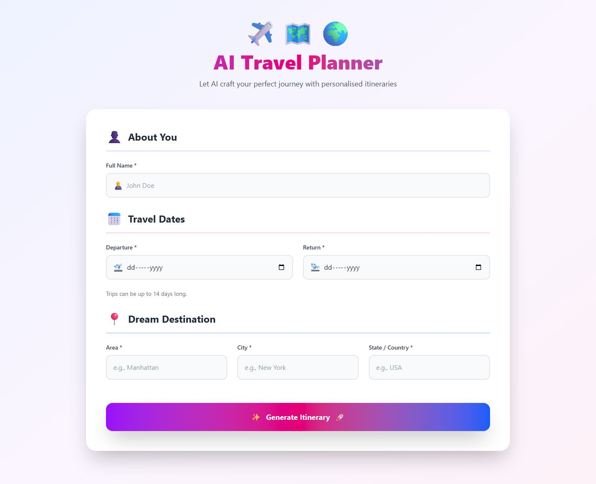
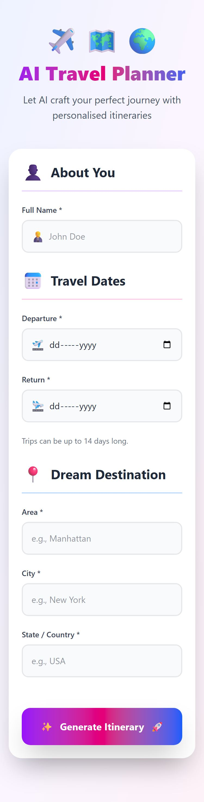
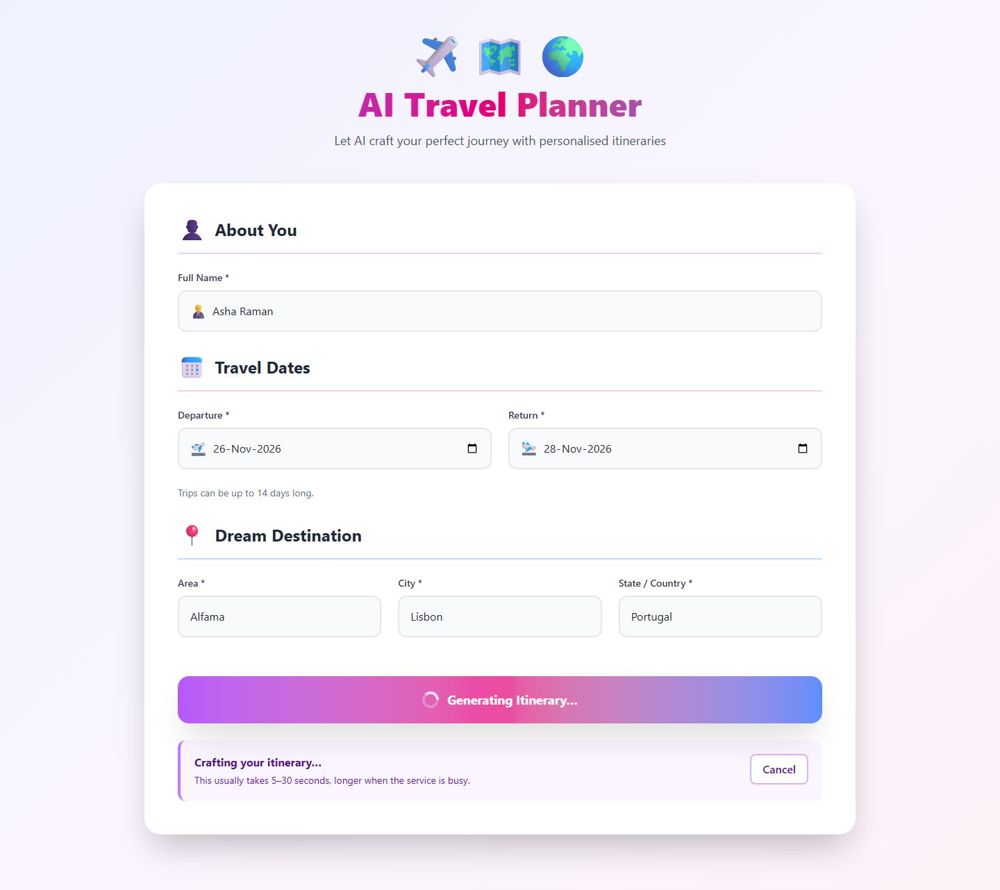
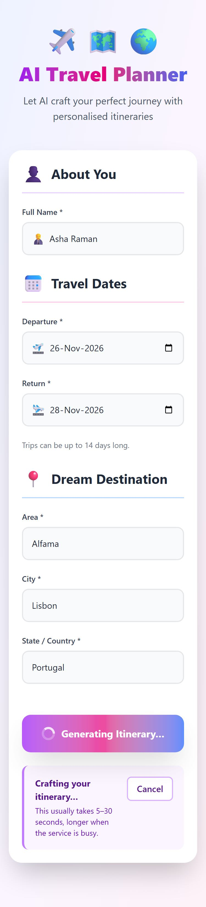
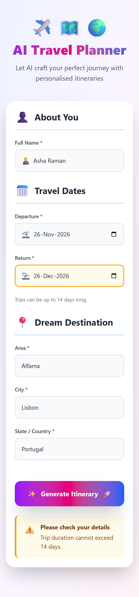
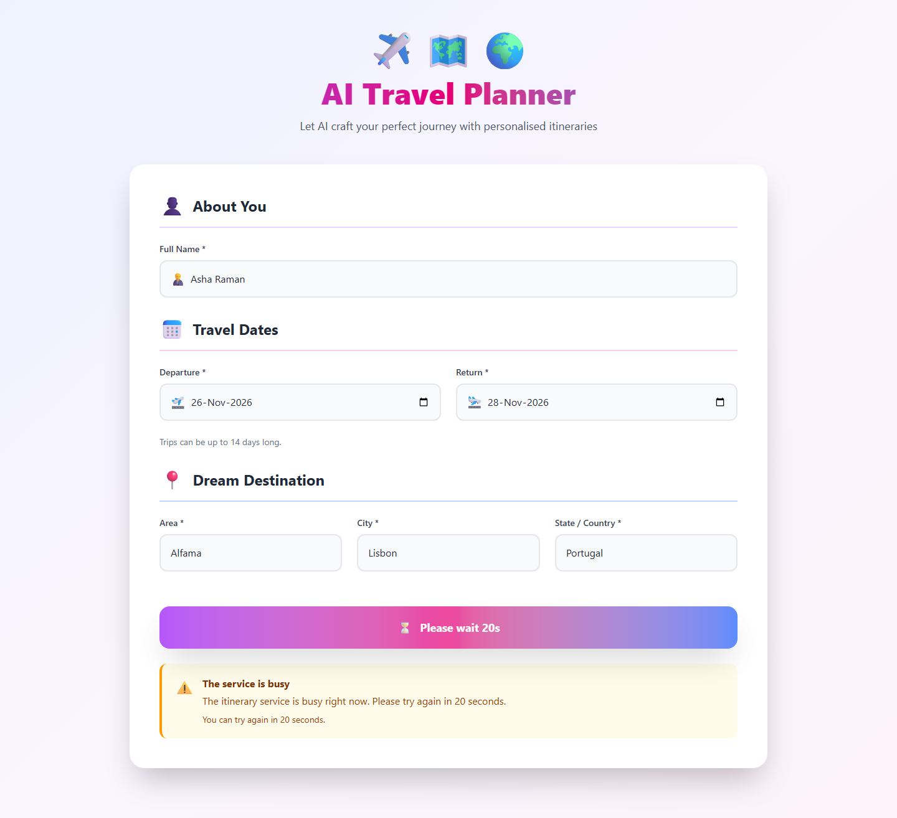
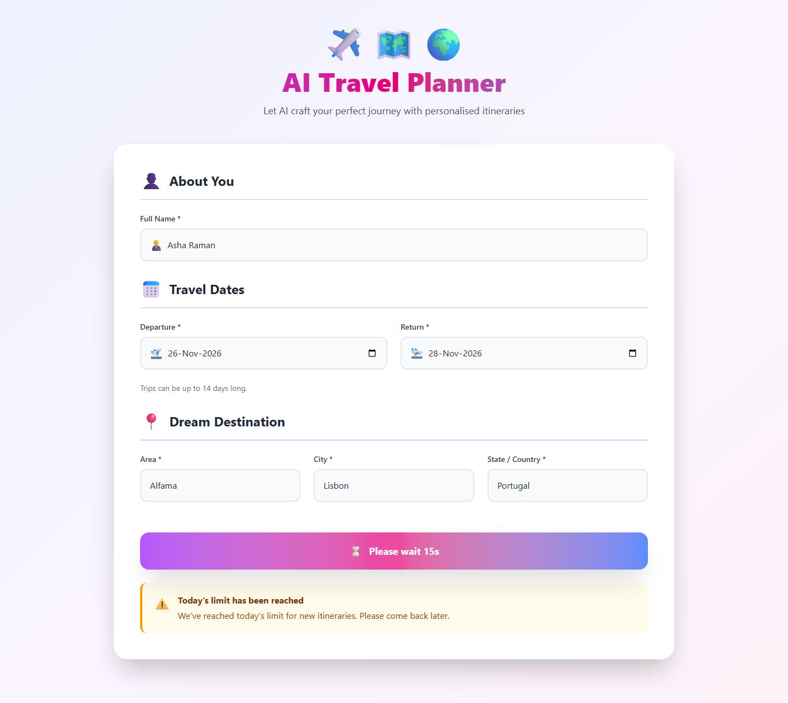
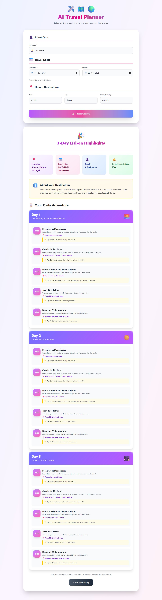
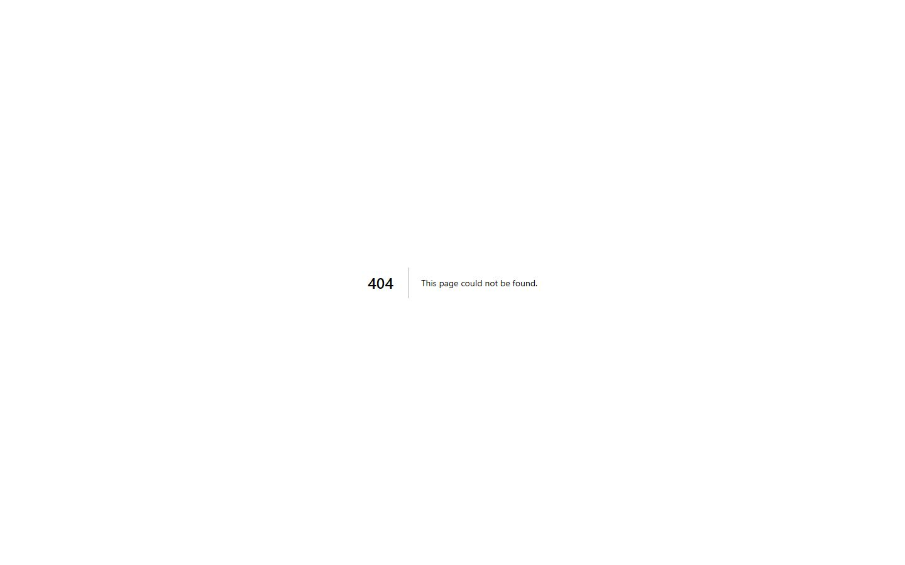

# UX research: frontend redesign

Status: research input for the redesign on `feat/ui-redesign`. The design tokens, type scale and component
specifications that follow from it belong in `docs/design/DESIGN_SYSTEM.md`. Where this document and that
one disagree on a value, `DESIGN_SYSTEM.md` wins; this document records the reasons.

Inputs:

- An audit of the current UI from the "before" screenshots (`screenshots/before/`, every screen at 1440 px
  and 375 px) and from the frontend code (`app/page.jsx`, `app/layout.js`, `app/globals.css`,
  `app/components/*`, `app/hooks/useTripGeneration.js`, `test/e2e/trip.spec.js`).
- A measured style study of greatify.ai, read with `getComputedStyle` in headless Chromium at 1440 px and
  375 px. No screenshots of it are kept in this repository.
- A study of travel-planning products (Wanderlog, Airbnb, Google Flights, Mindtrip, TripIt) and the NN/g
  guidance on loading states. Sources are listed at the end.

Measurement caveat: the contrast ratios for the current UI in section 2 were computed from Tailwind v4
palette hex values, not read from the rendered page. Re-measure them on the build before and after the
change.

---

## 1. Summary

- **The current UI reads as AI-generated** because of a specific set of traces: emoji used as icons on
  every screen, five competing multi-stop gradients (background, gradient-text headings, button, day
  headers, time tiles), `shadow-2xl` panels with cards nested four deep, `font-black` headings, hype copy
  ("craft your perfect journey", "Dream Destination", "Daily Adventure") and random palette colours with no
  tokens.
- **It also has real accessibility defects.** Two text pairs in the result fail WCAG AA (time tiles 2.76:1,
  day subtitle 3.22:1). Input borders are 1.24:1 against the panel. The invalid state is shown with colour
  only. The retry countdown sits inside `role="alert"` and may be re-announced every second. Smooth
  scrolling ignores `prefers-reduced-motion`. A successful result is never announced.
- **The flow is weak at the two moments that matter:** waiting (a small box under a long form, with no time
  context) and reading (the plan is appended below a still-filled form, the AI notice is at the very end,
  and on a phone the activity text column is about 151 px wide).
- **We will adopt the style of greatify.ai, not its colours:** one geometric grotesk on a 1.2 type scale
  with every heading at weight 600 and -0.02em tracking, a dark brand hero with one accent, a warm
  off-white content area, 1 px hairline borders instead of resting shadows, a 1200 px content width with
  left-aligned layouts, a radius ladder of 8 / 12 / 16 / 20 px, and one expo-out motion curve used
  sparingly and only under `motion-safe`.
- **We will adopt proven travel-product patterns:** a form that reads as one task (where, when, who) with
  a joined date range and a live day count; a skeleton of the real itinerary shape built only from the
  validated request while waiting, with an honest time estimate and elapsed seconds; a single-scroll
  itinerary with a time column, a quiet vertical rail and a day navigator (sticky list on desktop,
  contained chip row on mobile) that never hides a day.
- **Focus and announcements will follow the state machine:** Cancel during loading, the trip title on
  success, the first invalid field on a validation error, the error banner on a server error.
- **Nothing fabricated:** no logos, counts, ratings or sample itineraries. Every marketing line is one of
  the product's true facts (up to 14 days, five timed stops a day, an estimated budget, no account, usually
  5-30 seconds).
- **The e2e contract is kept.** Every string, label, role and structural rule the tests depend on is listed
  in sections 5 and 6. Four tested strings are worth changing; they are listed separately for the owner to
  decide.

---

## 2. Current UI audit

Severity: **blocker** (fails WCAG AA or breaks the task), **major** (clearly hurts the task or the
credibility of the product), **minor** (polish). Each finding links the before screenshot that shows it.

### 2.1 Screens

Landing at desktop and phone width:




Loading:




Errors:





Result:




404:



Other captures in the same folder: `form-filled-*`, `error-validation-1440`, `error-busy-375`,
`error-quota-375`, `not-found-375`.

### 2.2 Visual identity (why it reads as AI-made)

| # | Severity | Problem | Where | Evidence |
|---|---|---|---|---|
| 1 | Major | **Emoji used as icons everywhere.** Three in the hero, one per section heading (👤 📅 📍), inside the inputs (👨‍💼 🛫 🛬), ✨🚀 and ⏳ on the button, ⚠️/❌ in banners, 🎉 📍 📅 👤 💰 ℹ️ 📋 💡 in the result, 🌅/☀️/🌃 per day. They render as the OS emoji set, so the product looks different on every platform. This is the strongest template signal on the page. | All screens | [landing-1440](screenshots/before/landing-1440.jpg), [result-1440](screenshots/before/result-1440.jpg) |
| 2 | Major | **Five competing multi-stop gradients.** Page background indigo→purple→pink; gradient-text h1 (`page.jsx`); purple→pink→blue submit button (`TripForm.jsx:106`); gradient-text trip title; indigo→purple→pink day headers; purple→pink time tiles. No single focal point. | All screens | [landing-1440](screenshots/before/landing-1440.jpg), [result-1440](screenshots/before/result-1440.jpg) |
| 3 | Major | **No design tokens; random palette.** `globals.css` defines only background and foreground. Components use purple, pink, blue, indigo, amber, yellow, green, orange and gray directly. Each form section has its own focus colour (purple, pink, blue: `TripForm.jsx:50,68,93`), so colour carries no meaning. | All screens | [form-filled-1440](screenshots/before/form-filled-1440.jpg) |
| 4 | Major | **Geist is downloaded but probably never applied.** `layout.js` sets `--font-geist-sans` with a class on `<body>`; Tailwind v4 preflight sets `font-family` on `html` from `--default-font-family`, which resolves on `:root` where the variable is undefined. The page renders in the system font and looks like the default 404. Inferred from code; confirm with `getComputedStyle(document.body).fontFamily`. | All screens | [landing-1440](screenshots/before/landing-1440.jpg) vs [not-found-1440](screenshots/before/not-found-1440.jpg) |
| 5 | Major | **Heavy shadows and cards inside cards.** Form and result panels are `rounded-3xl shadow-2xl`; each day card is `shadow-xl`; each activity is a grey card inside it; each time tile is `shadow-lg`; each tip is a yellow callout inside the activity. Four levels of nested boxes. | Result | [result-1440](screenshots/before/result-1440.jpg) |
| 6 | Major | **No typographic system.** h1 and trip title are `font-black` (900); section headings are `text-2xl font-bold` for single fields; labels are small and light next to 24 px headings; no tracking; times without `tabular-nums`. | Landing, result | [landing-1440](screenshots/before/landing-1440.jpg) |
| 7 | Minor | **Hover effects imply interactivity that is not there.** Summary cards `hover:scale-105`, activities `hover:bg-purple-50`, locations in purple-700 that look like links, submit `hover:scale-[1.02]`. | Result, form | [result-1440](screenshots/before/result-1440.jpg) |
| 8 | Minor | **Everything is centred** (hero, trip header, notice, reset). At 1440 px about 200 px of empty gradient sits on each side of a single white card. | Landing | [landing-1440](screenshots/before/landing-1440.jpg) |
| 9 | Minor | **Starter-template leftovers.** `app/favicon.ico` is the create-next-app default (25,931 bytes); `public/` still holds `file.svg`, `globe.svg`, `next.svg`, `vercel.svg`, `window.svg`. "AI Travel Planner" is a category, not a product name. | Tab, `public/` | — |
| 10 | Major | **The 404 is the unstyled Next.js default.** No `app/not-found.jsx`, no brand, no way back to the planner. | 404 | [not-found-1440](screenshots/before/not-found-1440.jpg), [not-found-375](screenshots/before/not-found-375.jpg) |

### 2.3 Accessibility

| # | Severity | Problem | Measured | Evidence |
|---|---|---|---|---|
| 11 | **Blocker** | Time tiles: white bold 14 px text on purple-400→pink-400. | **2.79:1 / 2.76:1** (needs 4.5:1) | [result-1440](screenshots/before/result-1440.jpg), [result-375](screenshots/before/result-375.jpg) |
| 12 | **Blocker** | Day header subtitle ("Thu, Nov 26, 2026 • Alfama and Baixa"): 18 px regular, white at 90% on purple-500 with a 10% white overlay. Not large text. The "Day 1" title passes only as large text (3.62-3.87:1). | **3.22:1** (needs 4.5:1) | [result-1440](screenshots/before/result-1440.jpg) |
| 13 | Major | Input boundaries almost invisible: gray-200 border on white and on the gray-50 fill (WCAG 1.4.11 needs 3:1 to identify a control). | **1.24:1 / 1.18:1** | [landing-1440](screenshots/before/landing-1440.jpg) |
| 14 | Major | Invalid state is colour only: amber-500 border on amber-50; no inline message, no `aria-describedby`, focus not moved. At 375 px the highlighted Return field is about 1,000 CSS px above the banner that explains it. | **2.06:1** | [error-validation-375](screenshots/before/error-validation-375.jpg), [error-validation-1440](screenshots/before/error-validation-1440.jpg) |
| 15 | Major | The live hint "You can try again in N seconds." is inside `role="alert"` (`GenerationStatus.jsx:55-64`), so screen readers may re-read the alert on every tick. | — | [error-busy-1440](screenshots/before/error-busy-1440.jpg) |
| 16 | Major | `scrollIntoView({behavior:'smooth'})` (`page.jsx:28`) and `window.scrollTo({behavior:'smooth'})` (`page.jsx:49`) run under `prefers-reduced-motion`; `motion-safe:` classes do not cover JS scrolling. | — | code |
| 17 | Major | Success is silent: the polite live region just empties; focus is not moved to the trip; nothing says the plan is ready. | — | code |
| 18 | Minor | Disabled button countdown at `opacity-70`: "Please wait 20s" is status the user must read. Disabled controls are exempt, the information is not. | **3.12-3.61:1** | [loading-375](screenshots/before/loading-375.jpg), [error-quota-375](screenshots/before/error-quota-375.jpg) |
| 19 | Minor | Focus is `outline-none` plus a border colour that changes per section; no ring on inputs. | 3.58-4.12:1 | [form-filled-1440](screenshots/before/form-filled-1440.jpg) |
| 20 | Minor | Placeholder text about 3.0:1; the 14-day helper is not tied to the date inputs with `aria-describedby`. Heading levels are odd: the error banner is an h3 inside the "Dream Destination" h2; activities go down to h5. | ~3.0:1 | [landing-1440](screenshots/before/landing-1440.jpg) |

### 2.4 Layout at 375 px

| # | Severity | Problem | Evidence |
|---|---|---|---|
| 21 | Major | **Nesting crushes the activity column.** Padding stack main 16 + article 24 + `ol` 16 + `li` 16 per side, a 64 px time tile and a 16 px gap leave about **151 CSS px** for activity text; the Tip box inside is about 120 px. Titles wrap to 2-3 lines; one activity is about 330 px tall; a 3-day trip is about **8,700 CSS px**. A 14-day trip would be roughly four times that. | [result-375](screenshots/before/result-375.jpg) |
| 22 | Major | **The summary echoes the input in four huge cards** (destination, dates, traveller, budget), about 650 px before the first useful line. The estimated budget, the only new number, has the same weight as the traveller's name. | [result-375](screenshots/before/result-375.jpg) |
| 23 | Minor | Dates are inconsistent: raw ISO "2026-11-26 → 2026-11-28" in the summary, localised "Thu, Nov 26, 2026" in day headers. | [result-1440](screenshots/before/result-1440.jpg) |
| 24 | Minor | The hero pushes the task down: about 260 px at 1440 and about 470 px at 375 before the first field. | [landing-375](screenshots/before/landing-375.jpg) |
| 25 | Minor | The form is over-structured: three h2 sections with coloured rules for six inputs; "About You" is a section for one field. The form is about 1,200 px tall at 375. | [landing-375](screenshots/before/landing-375.jpg) |
| 26 | Minor | Native date inputs show "dd-----yyyy" with an emoji crammed beside them, which makes the browser default look broken. | [landing-375](screenshots/before/landing-375.jpg) |

### 2.5 Flow and state presentation

| # | Severity | Problem | Evidence |
|---|---|---|---|
| 27 | Major | **Loading is a small box under the button.** The page stays the filled form; fields remain editable during the request, so the form can disagree with the plan that comes back; progress is shown twice (button spinner and box); nothing shows elapsed time or what is being produced. | [loading-1440](screenshots/before/loading-1440.jpg), [loading-375](screenshots/before/loading-375.jpg) |
| 28 | Major | **The result is appended below a still-expanded form** with the old values and a disabled "Please wait 14s" button, so the page looks half-reset. Two competing "next" paths: edit the form above, or "Plan Another Trip" at the very bottom (which also clears the name). | [result-1440](screenshots/before/result-1440.jpg) |
| 29 | Major | **The quota error contradicts the button.** The banner says "come back later"; the button counts down "Please wait 15s" and then re-enables, inviting a retry that will fail. | [error-quota-1440](screenshots/before/error-quota-1440.jpg) |
| 30 | Major | **One wait is shown three ways, and they drift.** Server message "Please try again in 20 seconds" (static, goes stale), hint "You can try again in N seconds" (live), button "Please wait Ns" (live). | [error-busy-1440](screenshots/before/error-busy-1440.jpg), [error-busy-375](screenshots/before/error-busy-375.jpg) |
| 31 | Major | **The AI notice is not prominent:** small gray-500 centred text at the very end, after about 8,700 px on a phone. | [result-1440](screenshots/before/result-1440.jpg), [result-375](screenshots/before/result-375.jpg) |
| 32 | Minor | Day emoji are chosen by index (first, middle, last), not by content. | [result-1440](screenshots/before/result-1440.jpg) |
| 33 | Minor | The landing never says what you get (five timed stops a day, an estimated budget, up to 14 days, about 5-30 s, no account) or why the name is asked for. | [landing-1440](screenshots/before/landing-1440.jpg) |
| 34 | Minor | Long trips have no navigation: no day index or jump links; no print stylesheet. | [result-375](screenshots/before/result-375.jpg) |
| 35 | Minor | Three required destination fields add friction: someone going to "Kyoto" must invent an Area. Locked by the e2e labels and the request body; owner decision. | [landing-1440](screenshots/before/landing-1440.jpg) |

### 2.6 Information architecture today

```
main (pastel gradient)
 ├ header: 3 emoji, h1 "AI Travel Planner" (gradient text), slogan
 ├ white panel (shadow-2xl)
 │   ├ form: h2 About You [Full Name]
 │   │       h2 Travel Dates [Departure, Return, 14-day hint]
 │   │       h2 Dream Destination [Area, City, State/Country]
 │   ├ submit (idle | Generating Itinerary… | Please wait Ns)
 │   ├ aria-live="polite": loading box ("Crafting your itinerary…" + Cancel)
 │   └ role="alert": error banner (h3 title, server message, retry hint)
 └ result anchor → article (shadow-2xl)
     🎉 h2 title · 4 summary cards · About Your Destination ·
     h3 Your Daily Adventure → h4 Day N + ol of activities (h5) ·
     AI notice · ← Plan Another Trip
```

---

## 3. Reference: greatify.ai style

We take the **style system** (type, rhythm, geometry, surfaces, motion). We do not take its colours, brand,
content or proof elements. Values below were read with `getComputedStyle` at 1440 px and 375 px.

### 3.1 What we take, with measured values

**Typography**

| Property | Measured on greatify.ai | Use for us |
|---|---|---|
| Family | Yellix (commercial geometric grotesk), self-hosted via next/font with a size-adjusted fallback | One geometric grotesk that next/font self-hosts: Plus Jakarta Sans, Onest or Manrope (owner picks; see open questions) |
| Scale | Strict 1.2 ratio from 16 px: 11.11 / 13.33 / 16 / 19.2 / 21.67 / 23.04 / 33.81 / 39.81 / 47.78 | Same ratio. h1 48 (32 at 375), h2 40 / 32, card or day titles 23, small 13.33, badge 11.11 |
| Headings | Weight 600, letter-spacing -0.02em, line-height 1.2. No 700 or 800 in content | Same. No `font-black`, no `font-bold` headings |
| Body | 16/24, weight **500**, tracking -0.01em | 16/24. Weight 500 if the chosen family's 500 reads well at 16 px; otherwise 400 |
| Numbers | `tabular-nums` on numerals | `tabular-nums` on every time, date, count and price |
| 375 px | h1 32/38.4 (-0.64 px), h2 32/38.4, body unchanged | Same |

**Layout and rhythm**

| Property | Measured | Use for us |
|---|---|---|
| Container | max 1440 px, 120 px side padding → **1200 px content** | Same on desktop; 20 px gutters at 375 |
| Section padding | 96-120 px desktop; 64 px at 375 | 96 px desktop (120 for the hero), 64 px at 375 |
| Hero stack gaps | badge→h1 12, h1→subtext 12, subtext→CTA 36, CTA→facts 36 | Same |
| Grid gutters | 24 px (16 px between stat cards) | 24 px |
| Alignment | Left-aligned copy column; asymmetric heading-left, text-right sections | Left-aligned. Stop centring everything |

**Navigation bar**

- At the top: `position: fixed`, 91 px tall (24 px vertical padding), transparent over the dark hero.
- After scrolling: 61 px, `rgba(255,255,255,.8)` with `backdrop-filter: blur(24px) saturate(1.5)`, a 1 px
  bottom hairline `rgba(0,0,0,.1)`, shadow `0 6px 24px` at about 6% opacity; links switch to the dark brand
  colour. Background, shadow, border and padding transition over 300 ms `cubic-bezier(0,0,.2,1)`.
- Small CTA: 13.33 px / 600, padding 10/20, 36 px tall, radius 8.
- 375 px: 72 px tall.

For us: the bar holds only the product name and one anchor ("How it works" or "Plan a trip"). A hamburger
menu is not needed. The condense-on-scroll behaviour is CSS-cheap, but it needs a scroll listener or an
`IntersectionObserver` on a sentinel; that is acceptable within the JS budget if it is a few lines.

**Hero**

- Background: a near-vertical two-stop gradient (`176.9deg`, dark at 43.72%, accent at 141.44%). The accent
  stop sits beyond the bottom edge, so only a hint of it shows. This is a single brand gradient, not a
  rainbow, and it is the only gradient we keep.
- Headline: most words in the accent, the punchline word in the light colour. **No gradient text.** Each
  word is a span so it can rise in on load.
- Pill badge: `inline-flex`, gap 4, padding 6/8, 29 px tall, radius 8, 1 px border at 40% accent, fill at
  20% accent, 11.11 px / 600 text in the accent, 15 px icon. Their badge text measured 4.60:1; ours must be
  checked against our colours.
- Subtext: 16/24, weight 500, fixed 444 px width, light tint of the brand colour (8.17:1 on their hero).
- Facts row under the CTA: 13.33 px / 500, 14 px icons, about 24 px between items.
- Visual: glass cards in **isometric projection** (`rotate(-30deg) skewX(30deg) scaleY(0.866)`) over a grid
  of 72 px cells whose 1 px lines fade out radially. Glass panels: radius 12-16, translucent fill,
  `backdrop-filter: blur(10px)`, a 1 px light border on three sides as an edge highlight, shadow
  `0 4px 15px` at about 25%.

For us: the same composition built in CSS and inline SVG, with **schematic content only** (skeleton lines,
"Day 1", "09:00", "5 stops", "Estimated budget"). No invented places, prices or counts. The grid is two
`repeating-linear-gradient`s with a radial `mask-image`, `aria-hidden`. At 375 px hide it, or keep a band
no taller than 160 px, so the form is reached quickly.

**Surfaces**

- A warm off-white page area alternating with pure white panels. Resting cards have **no shadow**; they
  have a 1 px warm hairline (about 1.3:1 against the background, decorative only).
- Radius ladder: 8 (badges, buttons, inputs), 12 (small cards, form cards), 16 (panels, stat cards),
  20 (large blocks).
- Inputs: 48 px tall, radius 8, 1 px border, padding 0 12, 16 px text; labels 13.33 px / 500 above each
  field.
- Elevation appears only on hover for genuinely interactive cards (`translateY(-6px)` plus
  `0 16px 32px -12px` at 16%, 300 ms ease-out) and on floating elements.

For us: our input borders must reach **3:1** against their background (theirs do not need to meet our bar;
ours do). Hairlines stay decorative only.

**Stat and "how it works" blocks**

- Stat cards: 1 px hairline, radius 16, no fill or shadow, centred 40 px / 600 tabular numeral over a
  two-line 16 px / 500 label; 2×2 grid at 375.
- Two-column rows with a 1 px vertical divider: numeral and label on the left, description on the right.

For us: stat content limited to true facts ("14 days max", "5 stops a day", "~5-30 s", "No account").
Static, no count-up. The two-column divided row suits a three-step "How it works".

**Motion**

- Entrance: fade-up 24 px over 700 ms and per-word rise over 550 ms, both `cubic-bezier(.16,1,.3,1)`
  (expo-out), staggered. They switch these off under `prefers-reduced-motion: reduce`.
- Colour transitions 150 ms `cubic-bezier(.4,0,.2,1)`; nav condense 300 ms.

For us: one curve, `cubic-bezier(.16,1,.3,1)`. The hero entrance plays once, CSS only, under `motion-safe:`.
State changes use 150-250 ms per the design-system skill. Nothing loops except the loading skeleton.

### 3.2 What we deliberately do not take

- **Their colours.** Dark teal, bright green accent, cream off-white, their warm greys and the pastel
  peach, lavender and mint gradients. We keep the ideas (dark brand, one accent, warm off-white) with our
  own token values in `DESIGN_SYSTEM.md`.
- **Their brand.** Logo, wordmark, watermark glyph, illustrations, dashboard screenshots, beam and orb SVGs,
  icons.
- **All proof content.** Logo marquee, "trusted by" lines, compliance badges, uptime figures, case studies,
  quotes, integration logos and every invented-looking figure. We have no such facts and would be
  fabricating them.
- **Things that break our rules:**
  - `hover:scale(1.03)` on the CTA (banned by the design-system skill);
  - a bright-to-dark gradient CTA with white text (it measured **1.85:1** at the bright end; we use a solid
    accent that passes 4.5:1);
  - endless marquee, shimmer and bobbing loops;
  - JS count-up numerals;
  - a different numeral colour per row (breaks the one-accent rule);
  - pastel gradient cards and large decorative arcs (at most one subtle shape);
  - the browser-default 1 px input focus (we need a visible custom ring);
  - bright accent as text on light backgrounds (theirs measured 1.72:1).
- **The marketing-site length.** Audience tabs, demo-booking form, mega-footer. We are a single-task tool:
  hero, form, status, result.

### 3.3 Why it feels designed rather than generated

1. A strict type system: one family, a 1.2 scale, weight 600 headings with tight tracking; hierarchy from
   size alone.
2. A purpose-built hero visual of the product's own interface, not stock art or blobs.
3. Paper-like surfaces: warm off-white, hairlines, no resting shadows.
4. Precise geometry: a 1200 px edge, left-aligned asymmetric layouts, a fixed radius ladder.
5. Restrained motion: one curve, a single entrance, reduced motion honoured.

---

## 4. Travel product patterns to adopt

| # | Pattern | Seen in | Why it fits our task |
|---|---|---|---|
| P1 | **The form reads as one sentence: where, when, who.** One panel, three groups, small labels above values, one primary action. No section headings. | Airbnb search (segment label 12 px / 500 over a 14 px value) | Six fields are one task, not three sections. Removes about a third of the form height at 375. |
| P2 | **Joined date range.** Departure and Return in one bordered control with an inner divider, on one row even at 375 (Google Flights: 56 px tall desktop, 48 px at 375, 16 px text). | Google Flights | Makes the range visible as a range. At 375 each half is about 170 px, enough for a 16 px native date. Native `type="date"` stays (tests `.fill()` ISO strings). |
| P3 | **Prevent, then explain.** `min` on Departure (today, set after mount as now), `max` on Return = Departure + 13 days using `addDays` from `lib/domain/dates.js` (import only), and a live helper "3 days · up to 14". | Google Flights greys out invalid dates | Fewer validation round trips. The helper is derived from the inputs, so it is true. The 14-day validation message stays as the fallback. |
| P4 | **A skeleton of the real shape, built from the request.** Header with the destination and dates, a day navigator with real "Day 1 · Thu 26 Nov" items, five placeholder stop rows per day (five stops is a product fact). At most three skeleton days at full height. | NN/g guidance on skeletons for full-page loads | The user sees what is coming and where it will appear. Nothing in it is invented, because these values are what the server echoes back. |
| P5 | **An honest wait.** "This usually takes 5-30 seconds", an elapsed-seconds counter in `tabular-nums`, and copy that changes with time (from 15 s: "Longer trips take more time."; from 30 s: "The service may be busy. You can keep waiting or cancel."). No progress bar and no fake stages ("Finding restaurants…"). | NN/g: waits over 10 s need an explicit estimate. Counter-example: fake top progress bars (Wanderlog navigation, indie AI planners) | We have no real progress signal; a fake bar or staged steps would be fabricated. Elapsed time is true and reassuring. |
| P6 | **One scroll, every day rendered, with a day navigator.** Desktop: sticky "Days" list (about 220 px) beside the content, active day from `IntersectionObserver`, `aria-current`. Mobile: sticky, contained `overflow-x:auto` chip row, chips at least 44 px tall. | Wanderlog "Trip contents"; TripIt's linear timeline | Skimming, Ctrl+F and printing all work; the e2e tests need every day heading visible at once, so tabs and collapsed accordions are ruled out. |
| P7 | **Time as the left anchor of a day.** A right-aligned `tabular-nums` time column, a 1 px rail with a small dot per stop, then title, description, venue line with a pin icon, and a tip as an inset row. No per-stop cards. | Wanderlog stop list; Google Flights result rows | Time and order are the backbone of a day. Removing the nested cards gives the text column back its width at 375 (from about 151 px to about 270 px). |
| P8 | **Neutral category styling, one accent.** Pills and chips in grey; the accent kept for the primary action and the key number. | Wanderlog (grey pills), Mindtrip | Supports the one-accent rule; colour regains meaning. |
| P9 | **Summary as compact chips, not cards.** Destination, dates and day count, traveller, estimated budget; each with an icon and an sr-only label. Budget is the only chip that may use the accent. | Wanderlog trip header; Airbnb segment labels | The summary echoes what the user typed; it should cost one or two lines, not 650 px. |
| P10 | **Inline errors next to the cause.** Banner directly above the submit button; the invalid field gets a border, an inline message linked with `aria-describedby`, and focus. | Standard pattern (not observed live in the references) | The user sees the problem where they act. |
| P11 | **Print-friendly itinerary** (optional). `@media print` hides the hero, form, navigator and buttons. | TripIt users praise its print layout | People print or save travel plans. CSS only, no JS. Owner decision. |

Patterns we considered and do not adopt:

- **Travel-time connectors between stops** ("10 min walk", Wanderlog): we have no such data; inventing it
  would be fabrication.
- **Numbered map markers and a map pane**: no map, no image or tile sources under our CSP.
- **A full-screen search sheet on mobile** (Airbnb): adds a modal and focus trap for six fields that fit
  on the page.
- **A sample itinerary on the landing**: could be read as real output; we show an abstract outline instead.

---

## 5. User flow

### 5.1 Today

```
idle ──submit──► client validation ──fail──► error(VALIDATION_FAILED): banner under button,
  │                                          field aria-invalid, no request, no cooldown, focus stays
  │                └─pass──► submitting: button disabled "Generating Itinerary…", loading box + Cancel,
  │                          fields editable, Enter ignored
  │                            ├─ Cancel ──► idle (no cooldown)
  │                            ├─ success ─► result appended below form, smooth scroll (ignores reduced
  │                            │             motion), no focus move, no announcement, 15 s cooldown
  │                            └─ error ───► banner (title, message, hint), cooldown max(15, Retry-After)
  │                                          capped at 120, form values kept
  └─ "Plan Another Trip" ──► clears trip, error and all fields, smooth scroll to top; cooldown carries over
```

All of this behaviour (cooldowns, Cancel, the Enter guard, the field highlight, the 14-day limit, the
message per code) stays. What changes is presentation, focus and announcements.

### 5.2 Recommended

| State | What the user sees | Focus | Announced (polite unless stated) |
|---|---|---|---|
| **Idle** | Hero (badge, h1, subtext, facts row), then the planner panel. On desktop, a quiet "What you'll get" outline beside or under the form. | Natural order; no autofocus. | — |
| **Validation error** | Banner directly above the submit button. The invalid field: danger border (3:1 or more), inline message under it linked with `aria-describedby`, `aria-invalid="true"`. No request, no cooldown. | First invalid field. | The banner (`role="alert"`) once. |
| **Submitting** | Fields become **`readOnly`** (not `disabled`, so the Enter-key test can still press Enter in City, and values stay submitted with the form). The button shows "Generating Itinerary…" without a second spinner. The result area shows the status panel (title, "usually 5-30 seconds", elapsed seconds, Cancel) above a skeleton built from the request. | Move focus to **Cancel**, because the focused submit button has just become disabled and focus would otherwise fall to `<body>`. | Once: "Crafting your itinerary… This usually takes 5-30 seconds." The elapsed counter is `aria-hidden` (or outside the live region); the 15 s and 30 s copy changes may be announced once each. |
| **Cancelled** | Skeleton and status removed; form editable; no cooldown. | Submit button. | "Cancelled." (optional) |
| **Success** | The skeleton is replaced in place by the itinerary. The planner collapses to a one-line summary bar with an "Edit details" button; the form stays in the DOM (see note). Order inside the result: title, summary chips, AI notice, "Good to know" notes, day navigator, days, "Plan Another Trip". | **Trip title** (`h2` with `tabIndex={-1}`). Scroll it into view with `behavior: 'auto'` when `prefers-reduced-motion: reduce` matches, otherwise `'smooth'`. | "Your 3-day plan is ready." Must **not** contain the destination string or the traveller's name (see the strict-mode rule in section 6). |
| **Server or network error** | Skeleton removed (no placeholder content remains). Banner directly above the submit button with an inline SVG icon, the title per code, the fixed message and, for retryable errors, the live hint. Form values kept, fields editable. Cooldown on the button. | The banner container (`tabIndex={-1}`), because the button is disabled by the cooldown. Verify with NVDA that this does not double-read the alert; if it does, focus the banner heading instead. | The alert, once. The live countdown inside it is in a child with `aria-live="off"`. |
| **Plan Another Trip** | Clears trip, error and all fields (as today); planner expands; cooldown carries over. | First field (Full name). Scroll to top with the same reduced-motion rule. | — |

Note on the collapsed planner: the tests require exactly one `button[type="submit"]` at all times and
check, after success, that it is disabled and reads "Please wait Ns". `toBeDisabled` and `toContainText` do
not require visibility, so the form may be collapsed with the button inside it. If the e2e run shows
otherwise, keep the submit button visible in the summary bar. In either case the summary bar must not
repeat "Alfama, Lisbon, Portugal" or the traveller's name as text; "Lisbon · 2 days" is fine.

### 5.3 Errors and the cooldown

- **Retryable, timed (RATE_LIMITED, AI_BUSY):** the hint is the single live countdown; the button reads
  "Please wait Ns" (tested). The server message ("Please wait 42 seconds…") is static text from `lib/` and
  cannot change; that is acceptable once the hint is the visible, live number.
- **Retryable, untimed (AI_TIMEOUT, AI_INVALID_RESPONSE, INTERNAL, network):** hint "You can try again in N
  seconds." then "You can try again now." (tests match `/try again/`).
- **Not retryable (AI_QUOTA_EXHAUSTED, AI_REFUSED):** no hint (tests forbid `/try again (now|in \d+)/i` in
  the alert). The 15 s cooldown still runs. Recommendation for the owner: the button label for these codes
  should not suggest a retry. Only RATE_LIMITED and AI_BUSY are asserted to show "Please wait", so the
  label for quota and refused could stay "Generate Itinerary" while disabled, or read "Please wait Ns"
  as today. See open question 3.

---

## 6. Copy recommendations

Spelling stays British (personalised, traveller). One noun for the output: **plan** in prose,
**itinerary** where a tested string already uses it. Drop "journey", "adventure", "dream", "craft"
(except where tested), exclamation marks and emoji. Sentence case everywhere except tested strings.

### 6.1 Strings the e2e tests depend on (keep unless the owner approves a change)

| String | How the test uses it | Constraint |
|---|---|---|
| `Full Name *`, `Departure *`, `Return *`, `Area *`, `City *`, `State / Country *` | `getByLabel` (case-insensitive substring) | The ` *` must stay in the accessible name: do not `aria-hidden` it or move it to CSS `::after`. Each label unique. Case may change ("Full name *"). |
| `Generate Itinerary` | Submit `toContainText`, case-sensitive | Remove the emoji only. |
| `Generating Itinerary…` (U+2026) | Submit while loading, case-sensitive | Keep. |
| `Please wait \d+s` | Submit during cooldown (regex) | Remove ⏳. A space before "s" would break it. |
| `Crafting your itinerary…` | `getByText`, must be unique and visible while loading | Keep, or change with the selector (6.3). |
| `Cancel` | `getByRole('button', {name:'Cancel'})` | Only one button whose name contains "cancel". |
| Error titles: `Please slow down`, `The service is busy`, `Today's limit has been reached` (ASCII apostrophe), `That took too long`, `Couldn't create your itinerary`, `We couldn't plan that destination`, `Can't reach the server` | Exactly one heading inside the alert; full text compared exactly | No icon text or emoji inside the heading. |
| Server messages (`Please check your details`, `Trip duration cannot exceed 14 days.`, `wait 42 seconds`, `busy right now`, `come back later`, `shorter trip`, `incomplete itinerary`, `check it`, `unexpected error`, `took too long`) | Alert `toContainText` | Come from `lib/`; cannot change (owner rule 1). |
| `try again in \d+ seconds` / `try again` | Retry hint | Not shown for quota and refused. |
| `2-Day Lisbon Highlights`, `Day 1`, `Day 2` | `getByRole('heading')` | Trip title and each day label stay headings; all days visible at once. |
| `Alfama, Lisbon, Portugal`, `Asha Traveller`, `€340` | `getByText`, strict mode | Each in exactly **one** element on the page, including sr-only text and live-region announcements. Keep each as one contiguous text run. |
| `AI-generated suggestions. Check opening hours, prices and bookings before you travel.` | `getByText(/AI-generated suggestions/)`, unique and visible | Appears **once**. Must not carry `role="alert"`. |
| `Plan Another Trip` | `getByRole('button', {name:/Plan Another Trip/})`, case-sensitive | Replace the "←" text with an SVG icon. |
| Whole `body` on error screens | Must not match `/stack\|groq\|gsk_\|at \w+ \(/i` | No "Powered by Groq", no "stack"/"stacked" in copy, nothing like "at Foo (". |

### 6.2 Free text: current → new

| Where | Current | New | Reason |
|---|---|---|---|
| `<title>` | AI Travel Planner | `<Product name> · Day-by-day travel plans` | Category, not a name. Name is the owner's choice. |
| h1 | AI Travel Planner (gradient text) | "Plan a trip, day by day." (key words in the accent) | Says what the product does. |
| Subtitle | Let AI craft your perfect journey with personalised itineraries | "Tell us where and when. Get a day-by-day plan with five timed stops a day and an estimated budget." | Hype → specific, true. |
| Badge (new) | — | "Up to 14 days · No account needed" | True facts only. |
| Facts row (new) | — | "Up to 14 days · 5 timed stops a day · Estimated budget · Ready in about 5-30 seconds" | Explains the output before the user commits. |
| Meta description | Plan your perfect trip with a personalised AI-generated itinerary… / OG "…in seconds" | "Day-by-day travel plans for trips up to 14 days, with timed stops and an estimated budget. No account needed." | No hype; "in seconds" is vague. |
| Section headings | About You / Travel Dates / Dream Destination | None; groups labelled by `fieldset` legends "Where", "When", "Who" | One task, not three sections. |
| Name placeholder | John Doe | (none) | Template filler. |
| Name hint (new) | — | "Shown on your plan only." (optionally "+ It is not sent to the AI.") | Explains why we ask. The second sentence is true per `CLAUDE.md` but is a product claim; owner decides. |
| Date hint | Trips can be up to 14 days long. | Live: "3 days · up to 14" (before both dates: "Up to 14 days."), linked with `aria-describedby` | Derived from inputs; true. |
| Destination placeholders | e.g., Manhattan / e.g., New York / e.g., USA | e.g. Alfama / e.g. Lisbon / e.g. Portugal | Consistent style; not US-centric. |
| Loading body | This usually takes 5–30 seconds, longer when the service is busy. | "This usually takes 5–30 seconds." + elapsed "12 s" | Shorter; elapsed time is true. |
| Loading, after 15 s (new) | — | "Longer trips take more time." | Honest, not fake progress. |
| Loading, after 30 s (new) | — | "The service may be busy. You can keep waiting or cancel." | Gives the user a decision. |
| Result title prefix | 🎉 | (none) | Emoji. |
| Dates | 2026-11-26 → 2026-11-28 · 3 days | "Thu 26 Nov – Sat 28 Nov 2026 · 3 days" (UTC formatting) | Raw ISO; inconsistent with day headers. |
| Day subtitle | Thu, Nov 26, 2026 • Alfama and Baixa | "Thursday 26 Nov · Alfama and Baixa" | British order; consistent. |
| Budget label | Est. budget (excl. flights) | "Estimated budget" with "Excludes flights" below; value unchanged (`€340`) | No abbreviations. |
| Notes heading | About Your Destination | "Good to know" | Sentence case; plain. |
| Days heading | 📋 Your Daily Adventure | "Day by day" (or omit; the navigator labels the region) | Hype + emoji. |
| Tip | 💡 Tip: | "Tip" as a small label, no callout box | Emoji. |
| Missing time | (empty tile) | "—" with sr-only "Time not set" | Clarity. |
| Day icons | 🌅 ☀️ 🌃 | (none) | Meaningless. |
| Error icons | ❌ / ⚠️ | Inline SVG, `aria-hidden` | Emoji. |
| 404 | 404 · This page could not be found. | h1 "Page not found", line "This page doesn't exist.", link "Plan a trip" | Default page. |
| Footer (new) | — | One line: the AI notice is not repeated here; product name, "No account needed", link to the source repository if the owner wants it. No provider name. | Avoid the forbidden-body regex. |

### 6.3 Proposed changes to tested strings (owner decision; each needs a one-line selector change, no assertion weakened)

| Current | Proposed | Reason |
|---|---|---|
| `Crafting your itinerary…` | `Planning your trip…` (or `Planning your 3 days in Lisbon…`; must then stay unique and exact) | "Crafting" is hype. |
| `Please slow down` | `Too many requests` | The current title scolds. |
| `Generate Itinerary` / `Generating Itinerary…` | `Plan my trip` / `Planning…` | Sentence case; one noun. |
| `Plan Another Trip` | `Plan another trip` | Sentence case. |

If none are approved, the redesign ships with the current tested strings, minus emoji.

---

## 7. Screen-by-screen recommendations

### 7.1 Navigation bar

- Product name (wordmark set in the chosen font, no logo graphic until the owner supplies one) on the left;
  one anchor ("How it works") and a small CTA "Plan a trip" that jumps to the form on the right.
- Transparent over the hero at about 72-80 px; condenses to about 60 px with the translucent light
  background, `blur(24px)`, a 1 px hairline and a soft 6% shadow after scrolling. Transition 300 ms;
  instant under reduced motion.
- At 375: product name and the CTA only. No hamburger.
- A "Skip to planner" link as the first focusable element.

### 7.2 Landing and form

- **Hero** (dark brand, two-stop vertical gradient, the only gradient on the page): badge, h1 on two lines
  with key words in the accent, 444 px subtext, facts row. No separate hero CTA if the form follows
  directly; otherwise one solid accent button that scrolls to the form.
- **Hero visual** (desktop only, or a band of 160 px or less at 375): isometric glass cards over a fading
  grid, CSS and inline SVG, schematic content only, `aria-hidden`, no loops.
- **Planner panel** on the off-white area, white surface, radius 16, 1 px hairline, no shadow (or the one
  soft shadow if it overlaps the hero edge). At 1440 it may overlap the bottom of the hero by about 64 px
  to tie the two together.
  - Groups in reading order. Recommended order: **Where, When, Who.** The order of fields does not affect
    the tests (they use labels).
  - Where: Area / City / State / Country on one row on desktop (joined control), stacked at 375.
  - When: Departure | Return as one joined control, side by side at all widths; live day count; `min` and
    `max` as in P3. Leave the native date picker icon; add no emoji.
  - Who: Full name, with the hint.
  - Labels 13-14 px / 500 above inputs; inputs 48 px tall, radius 8, border at 3:1 or more; a 2 px focus
    ring in the accent (or brand) with a 2 px offset, at 3:1 or more against the surface.
  - Submit: solid accent, full width at 375 and 52 px tall; text contrast at least 4.5:1 in every state.
    The disabled state keeps readable text (reduce saturation, do not drop opacity below a passing ratio).
  - Validation and server errors appear above the submit button, inside the panel.
- **"What you'll get"** (desktop, beside or below the form): an abstract outline of a timeline (time bars,
  rail, line placeholders) and four true facts. On mobile, the facts row in the hero covers this.
- **How it works** (optional, below the planner): three two-column divided rows: "Enter where and when",
  "We draft five timed stops a day", "Check details before you book". No icons in coloured circles.

### 7.3 Loading

- The status panel and skeleton appear in the result area directly below the planner (desktop) or replace
  the view below the collapsed planner (375). Scroll the status into view if it is below the fold, with the
  reduced-motion rule.
- Status panel: neutral surface, 1 px hairline, title, estimate, elapsed seconds (`tabular-nums`,
  `aria-hidden`), time-based copy, Cancel as a secondary button (44 px or more; right-aligned on desktop,
  full width at 375).
- Skeleton: header bars for title and chips, the day navigator with real day labels, up to three days of
  five stop rows (time bar, title bar, two text bars). A slow opacity pulse (about 1.6 s) under
  `motion-safe:` only; static under reduced motion. No spinner anywhere else (the button text change is
  enough).
- Skeleton blocks are `aria-hidden`; the status panel carries the meaning.
- Do not render the destination string inside the skeleton as plain text that survives into the result
  state (it would duplicate `Alfama, Lisbon, Portugal`); the skeleton is removed when the result arrives.

### 7.4 Errors

- One banner component: neutral surface, 3 px left border in the warning or danger token, inline SVG icon
  (`aria-hidden`), heading with the exact title and nothing else, the server message, and the retry hint.
  Text pairs at 4.5:1 or more.
- `role="alert"` on the banner only. The live countdown is inside it in a `<span aria-live="off">` so it is
  not re-announced each second; the alert is announced once when it appears.
- Placement: above the submit button. Focus as in section 5.2.
- Validation: the field border in the danger token at 3:1 or more, an inline message under the field with
  a small icon, and `aria-describedby` to it. Keep `aria-invalid="true"` on the input.
- Quota and refused: no retry wording; consider a short secondary line "Your details are saved on this
  page." (true: the form keeps its values).
- Heading level: the banner heading is an `h2` (or `h3` if it sits inside a section with an `h2`); it is
  no longer nested under a "Dream Destination" heading.

### 7.5 Result

- **Header** on the page background (no card): `h2` trip title, 32/38 desktop and 26-28 at 375, weight 600,
  -0.02em. Under it, a wrapping row of summary chips (P9). The destination chip wraps (`min-w-0`,
  `overflow-wrap:anywhere`; radius drops to 12 px when it wraps).
- **AI notice** directly under the chips: one line with an inline info icon, muted text on a neutral
  tinted strip, 4.5:1 or more. It appears once (strict-mode rule), so it does not also go at the bottom.
  This replaces today's end-of-page placement.
- **Good to know**: `trip.notes` as a lead paragraph (18 px, muted). No amber callout.
- **Desktop (1024 px and wider)**: two columns. Left, a sticky `<nav aria-label="Days">` list (about 220 px,
  `top` below the condensed nav) with "Day 1" and "Thu 26 Nov · Alfama and Baixa" per item; active item
  with `aria-current="true"` and a 2 px accent bar. Right, the days at a reading width of about 720 px.
- **Mobile**: a sticky chip row under the nav ("Day 1 · 26 Nov"), contained horizontal scroll with
  `scroll-snap-type: x proximity`, chips 44 px tall; day sections get `scroll-margin-top` equal to the bar
  height plus 8 px. Hidden for one-day trips. Nav items are links (`#day-1`), so the browser handles the
  jump; use `behavior:'auto'` under reduced motion when scrolling the active chip into view.
- **Day section**: `h3` "Day 1" (kept exact for the tests), the long date and the day's location beside or
  under it, a 1 px rule. No coloured band, no emoji.
- **Stops**: `<ol>` timeline. Time column 64 px desktop / 52 px at 375, right-aligned, 14-15 px / 600,
  `tabular-nums`, ink colour. A 1 px neutral rail with an 8 px hollow dot per stop. Content: `h4` title
  (17 px / 600), description (15-16 px, muted, line-height 1.5), venue line with a 16 px pin icon and
  `overflow-wrap:anywhere` (test data includes a 60-character unbroken venue), tip as an inset row with a
  2 px left border and a "Tip" label. About 24 px between stops. No cards, no hover colour, no scale.
  At 375 this gives the text column about 270 px instead of 151 px.
- **End of trip**: "Plan Another Trip" as a secondary button with an SVG icon, left-aligned; optionally a
  "Print" button that calls `window.print()` if print styles are approved.
- Model text always renders as text (React escaping); no `` inside the `<article>`; icons are inline
  `<svg>`.
- The page must have no horizontal overflow at 375 with the filled form and with the result.

### 7.6 404 (`app/not-found.jsx`)

- Same nav and footer, off-white area, left-aligned block: `h1` "Page not found", one line "This page
  doesn't exist.", and a primary link "Plan a trip" to `/`. No illustration, no emoji. Readable at 375.

### 7.7 Footer

- One hairline-topped row on the off-white area: product name, a one-line description of what it is
  ("Day-by-day travel plans. No account needed."), and optionally a source-code link. Small text at 4.5:1
  or more.
- Do not name the AI provider or use the word "stack" (the error-screen regex checks the whole body).
- No social icons, newsletter, or link columns we cannot fill.

---

## 8. Constraints recap

**Scope (owner rule 1).** Frontend only: `app/` (except `app/api`), `public/`, `test/e2e` selectors. No
edits to `lib/`, `app/api`, or `package.json` dependencies. Importing from `lib/domain` (for example
`addDays`, `formatDate`) is allowed. Behaviour stays: message per error code, countdown, Cancel, field
highlighting, the 14-day limit, the 15 s cooldown, the AI notice text.

**CSP.** `default-src 'self'`, `font-src 'self'`, `img-src 'self' data:`. Fonts only through `next/font`
(self-hosted at build time). No external CDNs, images or icon fonts. Icons are inline SVG. The hero visual
is CSS and inline SVG. Inline styles set through React's `style` prop are fine; check that any
`<style>`-dependent technique works under the current `style-src`.

**No fabricated content (owner rule 2).** No logos, "trusted by" rows, user counts, ratings, testimonials,
sample itineraries, travel times or progress percentages. The only claims: up to 14 days, five timed stops
a day, an estimated budget (excluding flights), no account needed, results usually in about 5-30 seconds.
Skeletons are built only from the validated request.

**Accessibility (owner rule 3).** Text 4.5:1, large text and control boundaries 3:1, measured on the build.
A visible focus ring on every control. Labelled inputs with ` *` in the accessible name. Errors announced
once through the single `role="alert"`; success announced through a polite region; focus moved as in
section 5.2. `prefers-reduced-motion` stops CSS animation and makes JS scrolling instant. Touch targets 44
px or more. Heading order: `h1` page, `h2` trip title and banner, `h3` days, `h4` stops.

**Responsive (owner rule 4).** Checked at 375 px and 1440 px; no horizontal scroll
(`scrollWidth - clientWidth <= 0`); long text wraps.

**Tests (owner rule 5).** `test/e2e/trip.spec.js` runs in desktop and 375×740 projects. Selectors change
only where markup or approved copy changes; no assertion is weakened. Section 6.1 lists every dependency;
the strict-mode rules (one element per tested text, one `role="alert"`, one submit button, one heading in
the alert, one AI notice) are the ones a redesign most easily breaks.

**Dependencies (owner rule 6).** No UI kits, icon packages or animation libraries. Motion in CSS.

**Performance (owner rule 7).** First-load JS for `/` was 110 kB in the last build
(`docs/engineering/PRODUCTION_READINESS_REPORT.md`); the redesign must stay at or under about 125 kB.
Fonts are not counted in first-load JS, but keep to one family and the weights in use (500 and 600, plus
400 if body uses it); expect roughly 20-30 kB of woff2 per weight subset. Remove the unused Geist Mono
load and the starter files in `public/`. The day navigator's `IntersectionObserver` and the nav condense
logic should be a few lines each.

**Rendering.** The page is prerendered: nothing in the render path may depend on the current time.
Date `min` values and "today" are set after mount, as `page.jsx` does now. Dates are formatted in UTC
through `lib/domain/dates.js`.

---

## Open questions for the owner

1. **Product name** for the nav, `<title>` and favicon.
2. **Tested strings** in section 6.3: change any of them?
3. **Button label for quota and refused errors** while the 15 s cooldown runs: "Please wait Ns" (today)
   or the idle label in a disabled state?
4. **Area optional?** Needs an owner decision and a test change (the "Area *" label is asserted).
5. **Name hint**: state "It is not sent to the AI" in the UI?
6. **Font**: Plus Jakarta Sans, Onest or Manrope.
7. **Hero visual at 375**: hidden (recommended) or a band of 160 px or less.
8. **Print styles** for the itinerary.

## Sources

- NN/g, Skeleton Screens 101: https://www.nngroup.com/articles/skeleton-screens/
- Wanderlog public trip page (captured): https://wanderlog.com/view/paobwlbzbe/sample-trip-little-travellers?registerView=false
- Wanderlog vs TripIt (Wanderlog blog): https://wanderlog.com/blog/2024/11/26/wanderlog-vs-tripit
- Going, TripIt review: https://www.going.com/guides/tripit-review
- FlyerTalk TripIt thread: https://www.flyertalk.com/forum/19754337-post84.html
- Baymard, Airbnb date picker: https://baymard.com/ecommerce-design-examples/date-picker/10342-airbnb
- GoodUI, Airbnb search test: https://goodui.org/leaks/airbnb-a-b-tests-search-with-automatic-prompts-which-gets-rejected/
- Afar, AI travel planning apps tested: https://www.afar.com/magazine/we-tested-ai-travel-planning-apps-here-are-the-3-that-actually-worked
- Axios, Mindtrip: https://www.axios.com/2024/07/31/ai-trip-planner-travel-itinerary-mindtrip
- Tabidea, loading UX for an AI travel planner: https://engineer-blog.tomoki-ttttt.workers.dev/en/articles/tabidea-travel-tips-loading-ux/
- screensdesign, Layla: https://screensdesign.com/showcase/layla-ai-trip-planner
- Captured directly in headless Chromium: wanderlog.com, airbnb.com, Google Flights, mindtrip.ai,
  tripit.com, greatify.ai. Not captured: Layla (region-blocked), Mindtrip and Layla while generating, the
  TripIt app, Airbnb's open calendar.
