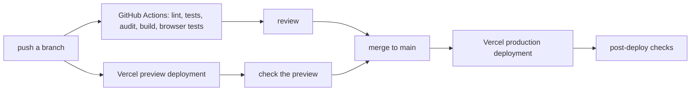

# Deployment

How to configure, deploy, check and roll back the AI Travel Planner on Vercel.

- **Platform:** Vercel, Node.js 22+ (`engines` in `package.json`). No change of platform is planned.
- **External services:** Groq (required), Upstash Redis (optional, recommended), GitHub Actions (CI).
- **Cost at current settings:** nothing. Groq free plan, Upstash free tier, Vercel Hobby.

---

## 1. Environment variables

Set these in Vercel under **Project → Settings → Environment Variables**. A change only takes effect on the
next deployment. None of them is prefixed `NEXT_PUBLIC_`; none reaches the browser.

| Variable | Required | Default | Purpose |
|---|---|---|---|
| `GROQ_API_KEY` | **Yes** | — | Key from https://console.groq.com/keys |
| `GROQ_MODEL` | **Yes** | — | Model ID. Currently `openai/gpt-oss-120b`. There is deliberately no default in code |
| `AI_PROVIDER` | No | `groq` | Only `groq` is supported |
| `GROQ_REASONING_EFFORT` | No | `low` | Passed to Groq unchanged |
| `AI_TIMEOUT_MS` | No | `50000` | Overall generation deadline, 5,000–55,000. The route allows 60 s |
| `AI_MAX_OUTPUT_TOKENS` | No | `10000` | Ceiling for the per-request output cap |
| `AI_DAILY_REQUEST_BUDGET` | No | `900` | Generations per day, all visitors. Free-plan limit is 1,000 |
| `AI_DAILY_TOKEN_BUDGET` | No | `180000` | Tokens per day, all visitors. Free-plan limit is 200,000 |
| `RATE_LIMIT_PER_MINUTE` | No | `5` | Requests per visitor per minute |
| `RATE_LIMIT_PER_DAY` | No | `30` | Requests per visitor per day |
| `RATE_LIMIT_TOKENS_PER_DAY` | No | `30000` | Groq tokens per visitor per day, so one visitor cannot use the whole daily budget |
| `CACHE_TTL_SECONDS` | No | `86400` | How long an identical request is served from the cache. `0` disables it |
| `UPSTASH_REDIS_REST_URL`, `UPSTASH_REDIS_REST_TOKEN` | No | — | Shared store. `KV_REST_API_URL` and `KV_REST_API_TOKEN` are accepted instead |
| `ADMIN_TOKEN` | No | — | Enables the usage report and the provider probe. At least 32 random characters; a shorter value is ignored |

An invalid value (for example a timeout above 55,000) does not take effect. `/api/health` then returns 503
with `"config": "invalid"`, and `POST /api/trips` returns "service not available" until it is corrected.

### Preview versus Production

Use the same Groq key in both, or a separate key for Preview. If they share a key they share Groq's limits,
so give Preview small budgets (`AI_DAILY_REQUEST_BUDGET=50`, `AI_DAILY_TOKEN_BUDGET=20000`) to stop tests
using up production's allowance.

---

## 2. One-time setup

### Groq

1. Create a key at https://console.groq.com/keys.
2. Add `GROQ_API_KEY` and `GROQ_MODEL=openai/gpt-oss-120b` to the **Production** and **Preview** environments.
3. Before changing the model later, read https://console.groq.com/docs/models and
   https://console.groq.com/docs/deprecations. Groq has retired models with about three weeks' notice.

### Upstash Redis (recommended)

Without a shared store, rate limits, the daily budget and the cache live in each server instance's memory.
They still work, but they reset on every cold start and are not shared between instances.

1. In Vercel: **Storage → Create Database → Upstash → Redis**, free plan, in the same region as the
   functions (the default is `iad1`, Washington D.C.).
2. Connect it to this project for Production and Preview. Vercel adds `KV_REST_API_URL` and
   `KV_REST_API_TOKEN`, which the application reads. No code change is needed.
3. Redeploy. `/api/health` should then show `"store": "ok"` instead of `"store": "memory"`.

### Vercel firewall rule (optional backstop)

One rate-limit rule is included on the Hobby plan. It rejects floods before a function runs.

**Firewall → Add New Rule:** if *Request Path* equals `/api/trips`, then *Rate Limit*, fixed window,
60 seconds, 20 requests, keyed by IP, action 429. The application's own limit of 5 per minute remains the
precise one; this only stops abuse from costing function invocations.

### GitHub

1. **Settings → Branches → Add rule** for `main`: require a pull request, and require the status check
   **Lint, test, audit, build, browser tests** to pass.
2. CI needs no secrets: no test contacts Groq.

### Vercel project settings to confirm

- **Settings → Functions:** Fluid Compute enabled. The route sets a 60-second limit explicitly, which is
  allowed either way.
- **Settings → Git:** `main` is the production branch; pull requests get preview deployments.

---

## 3. Deploying



Before merging, on your machine:

```bash
npm run verify        # lint, unit and integration tests, build, browser tests
```

### Checking a preview or production deployment

Replace `$URL` with the deployment's address.

```bash
# 1. Health: expect {"status":"ok","checks":{"config":"ok","store":"ok" or "memory","ai":"configured"}}
curl -s $URL/api/health

# 2. Guards (no AI call): expect 400 with code VALIDATION_FAILED, then 403
curl -s -X POST -H 'Content-Type: application/json' -d '{}' $URL/api/trips
curl -s -X POST -H 'Content-Type: application/json' -H 'Sec-Fetch-Site: cross-site' -d '{}' $URL/api/trips

# 3. Provider reachable, without spending tokens (needs ADMIN_TOKEN): expect "ai":"reachable"
curl -s -H "Authorization: Bearer $ADMIN_TOKEN" "$URL/api/health?probe=ai"
```

4. In the browser, generate one short trip and one 14-day trip.
5. In **Vercel → Logs**, find the `trip_request` lines. Each should have `status: 200`, a `model`, and token
   counts. `recovered: true` means Groq rejected its own output and the itinerary was salvaged; that is
   expected for roughly one in five long trips.

### Cutover from Gemini (the first deployment of this version)

1. Add the Groq variables to Production. The currently deployed code ignores them, so this is safe in advance.
2. **Leave `GEMINI_API_KEY` in place.**
3. Merge the pull request and run the checks above on production.
4. Keep the Gemini key for two weeks, then delete it from Vercel and from Google AI Studio.

---

## 4. Rollback

**Vercel → Deployments →** the previous production deployment **→ ⋯ → Promote to Production** (or
"Instant Rollback"). It takes effect in seconds and needs no code change.

- Rolling back **to the Gemini version** works only while `GEMINI_API_KEY` is still set in Vercel.
- Environment variables are read at deploy time, so a rolled-back deployment uses the values it was built with.
- A bad configuration value is fixed by correcting it and redeploying, not by rolling back.

---

## 5. Operating it

| Question | Where to look |
|---|---|
| Is it up and configured? | `GET /api/health` |
| Can it reach Groq? | `GET /api/health?probe=ai` with the admin token. Spends no tokens |
| How much was used today? | `GET /api/usage` with the admin token: requests, generations, cache hits, tokens, errors by code |
| Why did one request fail? | The response's `requestId` (also the `X-Request-Id` header) matches one `trip_request` log line, which carries `code` and `providerKind` |
| Is the shared store down? | `"store": "degraded"` on health, and `store_degraded` log lines. The site keeps working on in-memory limits |

### What visitors see when limits are reached

| Situation | Response | Message |
|---|---|---|
| One visitor sends more than 5 requests in a minute | 429 `RATE_LIMITED` | "Too many requests. Please wait N seconds…" |
| Groq's per-minute allowance is used up | The request waits up to 30 s and retries once; if still refused, 503 `AI_BUSY` | "…busy right now. Please try again in N seconds." |
| The daily budget or Groq's daily limit is reached | 503 `AI_QUOTA_EXHAUSTED` | "We've reached today's limit for new itineraries. Please come back later." |

On the free plan the site can produce about one 14-day itinerary per minute and roughly 30 to 90 itineraries
a day. To raise that, move the Groq account to the Developer plan and increase `AI_DAILY_REQUEST_BUDGET` and
`AI_DAILY_TOKEN_BUDGET`. No code change is needed.

### Rotating the Groq key

Create a new key, replace `GROQ_API_KEY` in Vercel, redeploy, confirm with the provider probe, then delete the
old key in the Groq console.

---

### Client identity

Visitors are identified by the `x-real-ip` header, which Vercel sets and clients cannot change. IPv6
addresses are grouped by /64. If the app is ever hosted elsewhere, the proxy in front of it must set
`x-real-ip`; otherwise every visitor shares one rate-limit bucket.

## 6. Known limits of this setup

- **Vercel Hobby** is for non-commercial use. A commercial launch needs the Pro plan.
- **Free-plan capacity** is shared by every visitor (see above).
- **No monitoring or alerting** is configured. Failures are visible in Vercel's logs and the usage report, but
  nothing notifies anyone. Vercel's log drains or a scheduled check of `/api/health` would add that.
- **Logs** are kept for a short period on the Hobby plan.
