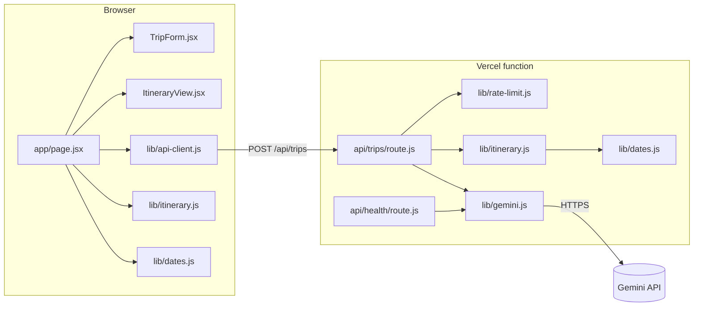

# Initial Audit — AI Travel Planner

- **Date:** 2026-11-15
- **Commit audited:** `89a996d` (`main`, in sync with `origin/main`)
- **Scope:** every tracked source file, configuration, git history, the local build, and the live deployment.
- **Application code changed during this audit:** none.

Every statement below is labelled by how it was established:

- **Measured** — a command was run and its output is quoted.
- **Read** — established by reading the file at the cited line.
- **Claimed** — stated in existing documentation and not re-verified here.
- **Inferred** — follows from the code or platform behaviour but was not directly observed.

---

## 1. Baseline check results

| Check | Result | Evidence |
|---|---|---|
| Toolchain | Node 24.15.0, npm 11.12.1 | Measured |
| `npm ci` | **Pass.** 82 packages in 10 s | Measured |
| `npm run build` | **Pass.** Next.js 15.5.29, compiled in 5.0 s. `/` is static (5.33 kB, 108 kB first-load JS); `/api/health` and `/api/trips` are dynamic | Measured |
| `npm run lint` | **Fail (exit 1).** `next lint` is deprecated, ESLint is not installed, and the command stops at an interactive setup prompt | Measured |
| Tests | **None exist.** No `test` script, no test files, no test runner | Measured |
| `npm audit` | **Pass.** 0 vulnerabilities (all and production-only) | Measured |
| `npm outdated` | `@google/genai` 3.1.0 → 3.3.0, `tailwindcss` 4.1.17 → 4.3.5, `next` 15.5.29 is the newest 15.x (16.4.6 is the next major) | Measured |
| Local production smoke (`next start`) | **Pass.** Page 200; health OK; validation returns the right 400s; the 6th request in a minute from one IP gets 429 | Measured |
| Live deployment | **Pass.** `/api/health` → `{"status":"ok","aiConfigured":true,"model":"gemini-3.5-flash-lite"}`; `GET /api/trips` → 405; empty body → 400; non-JSON → 415; `Sec-Fetch-Site: cross-site` → 403; CSP, HSTS, `X-Frame-Options`, `nosniff` all present | Measured |
| Real AI generation | **Not run.** It would spend Gemini quota, which the documentation says is 20 requests per day on the free tier. The latency figures in `PROJECT_STRUCTURE.md` are therefore Claimed, not Measured | — |

The build log prints "Linting and checking validity of types", but with no ESLint installed and no TypeScript
that step checks nothing. A passing build is currently the only automated gate, and it only proves that the
code compiles.

---

## 2. Existing architecture

About 1,055 lines of JavaScript in 11 source files.

### Module responsibilities (Read)

| Module | Lines | Responsibility | Assessment |
|---|---|---|---|
| `lib/dates.js` | 35 | UTC calendar-date parsing and arithmetic | Sound. Keep as is |
| `lib/itinerary.js` | 230 | Request validation, prompt, JSON schema, model-output parsing and normalisation | Sound core, but four responsibilities in one file and the schema is in Gemini's dialect |
| `lib/gemini.js` | 120 | Gemini SDK call, timeout, error classification; also defines `AIServiceError` | Works. The application error type lives inside the provider module |
| `lib/rate-limit.js` | 43 | Fixed-window in-memory limiter, client key from headers | Correct for one process; not global on serverless |
| `lib/api-client.js` | 51 | Browser fetch wrapper and error mapping | Sound. No machine-readable error codes to work with |
| `app/api/trips/route.js` | 106 | Origin and content-type guards, rate limit, validation, AI call, error-to-HTTP mapping, logging | Holds the whole use case; imports the provider directly |
| `app/api/health/route.js` | 13 | Reports key presence and model name | Imports the provider directly |
| `app/page.jsx` | 151 | All UI state, submit flow, cooldown, abort | Acceptable at this size |
| `TripForm.jsx`, `ItineraryView.jsx` | 273 | Presentational | Sound |

There are no circular dependencies. No unused runtime dependencies: `@google/genai`, `server-only`, `next`,
`react` and `react-dom` are all used.

### Current request lifecycle (Read, `app/api/trips/route.js`)

1. Reject `Sec-Fetch-Site: cross-site` (403) and non-JSON content types (415).
2. In-memory rate limit, 5 per minute per `x-forwarded-for` value (429).
3. Parse the body (400), then `parseTripRequest` (400).
4. One `generateContent` call to Gemini with a 50 s timeout, no retry, no cache.
5. `parseModelJson` → `normalizeItinerary` (502 if unusable).
6. Return `{ success: true, trip }`.

### Current AI integration (Read, `lib/gemini.js`)

- `@google/genai` 3.1.0, API version `v1beta`, model from `GEMINI_MODEL` with a hard-coded default of
  `gemini-2.5-flash`. Production runs `gemini-3.5-flash-lite` (Measured, live health endpoint).
- JSON mode with a response schema. The schema deliberately omits `minItems` and `maxItems`.
- Thinking is disabled only when the model name starts with `gemini-2.5-flash`.
- A new SDK client is constructed on every request.
- Token usage returned by Gemini (`usageMetadata`) is discarded.

---

## 3. What is sound and should be kept

These were checked and found to be correct. Rewriting them would add risk for no benefit.

- **Date handling** (`lib/dates.js`): UTC arithmetic, rejects roll-over dates such as 30 February (Measured).
- **Shared validation**: the form and the API call the same `parseTripRequest`, so the rules cannot drift.
- **Trust boundary**: destination, dates and traveller name in the response come from the validated request,
  never from the model (`lib/itinerary.js:219-229`).
- **Prompt hygiene**: the destination is inserted JSON-quoted, and the traveller's name is not sent to the model.
- **Secret isolation**: the key is read only in a module guarded by `server-only`; nothing AI-related is
  `NEXT_PUBLIC_`; no key pattern exists in the current tree (Measured).
- **Security headers** in `next.config.mjs`, confirmed on the live site (Measured).
- **Cancellation**: the browser's abort signal reaches the provider call.
- **Honest failures**: there is no sample or fallback itinerary.
- **Model output is rendered as text only**: no `dangerouslySetInnerHTML`, no links built from model output.

---

## 4. Findings

### P0 — Critical

**F-01 · A Google API key is in the public repository's history**

- **Where:** `app/index.js` and `app/api/trips/utils.js` in early commits. Not present in `HEAD`.
- **Evidence:** Measured. One distinct 39-character Google-style key appears across the history. Its hash
  differs from the key in the local `.env.local`, so it is not the key in use on this machine.
- **Root cause:** the key was hard-coded in source before environment variables were adopted.
- **Impact:** anyone can read it from GitHub. `GEMINI_API_SETUP.md` says Google disabled it (Claimed). This
  audit did not test the key, because using a leaked credential is not appropriate.
- **Proposed solution:** the owner confirms in Google AI Studio that the key is deleted, not merely
  restricted. If it is deleted, this finding closes with no code change and no history rewrite. Rewriting
  public history is destructive and does not un-leak a key, so it is not recommended.
- **Priority:** P0 until the owner confirms deletion. It then drops to informational.

The MongoDB connection strings in history were also checked (Measured): they are placeholders
(`username:password@cluster…`), not real credentials.

### P1 — Major

**F-02 · There are no automated tests**

- **Where:** whole repository.
- **Evidence:** Measured. No test script, files or runner. `CLAUDE.md` describes a `node:test` suite,
  `npm test` and `npm run verify`; none has ever been committed (Measured, `git log --all`).
- **Root cause:** the tests described in `CLAUDE.md` were never added to the repository.
- **Impact:** every change, including the provider migration, is unverifiable except by hand. The most
  delicate logic (output normalisation, error classification) has no regression protection.
- **Proposed solution:** add a `node:test` suite before any refactoring. Start with characterisation tests
  of current behaviour for `dates`, `itinerary`, `rate-limit` and the route. No new dependency is needed.

**F-03 · Lint is broken**

- **Where:** `package.json:12`.
- **Evidence:** Measured. `npm run lint` exits 1 at an interactive prompt; ESLint is not installed.
- **Root cause:** `next lint` was left in place without installing ESLint, and Next.js has deprecated it.
- **Impact:** no static analysis. Hook-dependency and unused-variable mistakes go unnoticed.
- **Proposed solution:** install ESLint 9 with `eslint-config-next`, add a flat config, and change the
  script to `eslint .`.

**F-04 · No CI, and production deploys are ungated**

- **Where:** no `.github/` directory (Measured).
- **Evidence:** Inferred from Vercel's default Git integration: a merge to `main` deploys to production.
  The only check on that path is that the build compiles.
- **Impact:** a broken change can reach production with nothing to stop it.
- **Proposed solution:** a GitHub Actions workflow that runs install, lint, tests, audit and build on every
  pull request, plus branch protection on `main`.

**F-05 · The rate limit is not global and there is no overall spending cap**

- **Where:** `lib/rate-limit.js`, `app/api/trips/route.js:17-18`.
- **Evidence:** Read. Counters live in a per-process `Map`, which is lost on every cold start and redeploy
  and is not shared between instances. Measured locally: a request with a different `X-Forwarded-For` value
  gets a fresh bucket. On Vercel itself the header cannot be spoofed, because the platform overwrites it
  (Vercel request-headers documentation, read 2026-11-15), so the per-IP key is trustworthy in production
  and only the storage is the problem.
- **Root cause:** state is held in instance memory on a platform that runs several instances.
- **Impact:** the limit of 5 per minute is per instance and per IP. Nothing limits total generations per day,
  so a handful of clients can exhaust the provider's daily quota for everyone.
- **Proposed solution:** a shared-store limiter with two limits: per IP, and a global daily budget that sits
  below the provider's quota. The limiter sits behind an interface so the in-memory version remains the
  local and fallback implementation.

**F-06 · Identical requests always regenerate**

- **Where:** `app/api/trips/route.js:72-81`.
- **Evidence:** Read. There is no cache and no de-duplication of in-flight requests. The only protection is
  a 15 s cooldown in the browser, which is not a server control.
- **Impact:** two tabs, a refresh, or two people asking for the same city and dates each cost a full
  generation of up to roughly 10,000 output tokens.
- **Proposed solution:** a response cache keyed on the normalised destination, the dates, the prompt and
  schema version, and the model. The traveller's name is excluded from the key and re-attached after the
  cache lookup. In-flight de-duplication uses the same key.

**F-07 · Daily quota exhaustion is reported as "wait a minute"**

- **Where:** `lib/gemini.js:55`, `app/api/trips/route.js:31,96-97`.
- **Evidence:** Read. Every provider 429 becomes `rate_limited`, which returns "The AI service is busy right
  now. Please wait a minute and try again" with a hard-coded `Retry-After: 60`. The provider's own retry
  information is ignored.
- **Root cause:** one error kind covers two different conditions.
- **Impact:** when the daily quota is gone, users are told to retry in a minute, do so, and fail again. Each
  retry is another wasted call. The documentation names quota exhaustion as the main known limitation, so
  this is the most likely failure users actually meet.
- **Proposed solution:** separate `rate_limited` (retry soon, honour the provider's `Retry-After`) from
  `quota_exhausted` (do not retry; tell the user to come back later).

**F-08 · The AI provider is wired directly into the route**

- **Where:** `app/api/trips/route.js:10`, `app/api/health/route.js:1`, `lib/gemini.js:26`,
  `lib/itinerary.js:108`.
- **Evidence:** Read. Both routes import `lib/gemini.js`. `AIServiceError` is defined in the Gemini module.
  The response schema is written for Gemini's dialect, and the thinking setting is chosen by model-name prefix.
- **Impact:** changing provider means editing the route, the health check, the schema and the error type
  together. There is no seam at which a fake provider can be substituted in tests.
- **Proposed solution:** a small provider contract (`generateStructured`) with application-level errors
  defined outside any provider. This is the core of the migration.

**F-09 · One long request with no recovery**

- **Where:** `lib/gemini.js:14-16`, `lib/itinerary.js:8`.
- **Evidence:** Claimed in `PROJECT_STRUCTURE.md`: a 14-day trip takes 31–34 s against a 50 s timeout, and
  30 days times out. Read: there are no retries, so one transient provider error loses the whole request.
- **Impact:** long trips run close to the limit, and any transient failure is shown to the user.
- **Proposed solution:** decide between single-request and chunked generation using measurements on Groq,
  and add bounded retries for transient failures only. See the HLD.

### P2 — Engineering quality

**F-10 · Model-output validation has gaps** (`lib/itinerary.js:170-217`, Read)

- A `time` that is not `HH:MM` is kept as free text up to 12 characters, so "morning-ish" passes.
- A day is accepted with a single activity when five were requested.
- Extra days are silently dropped. The model's own `date` and `day` values are never compared with the
  requested dates, so a reordered response would be shown under the wrong dates.
- Activities are not checked for chronological order.
- **Solution:** strict validation with explicit rules for time format, a minimum activity count, date
  agreement and ordering. Decide per rule whether to repair or reject, and test each one.

**F-11 · The error contract cannot be acted on by the client** (`route.js:22-24`, `lib/api-client.js`, Read)

- Errors are `{ error: "text" }` with no machine-readable code, and success is `{ success, trip }`. The
  browser can only display a string, so it cannot tell quota exhaustion from a timeout from invalid input.
- **Solution:** one envelope with a stable `code`, a safe `message`, `retryable`, `retryAfterSeconds` and a
  `requestId`.

**F-12 · Logging is unstructured and has no correlation ID** (`route.js:80-103`, Read)

- Free-form `console.info` and `console.error` calls. No request ID. Token usage is discarded
  (`lib/gemini.js:119` returns only the text).
- **Solution:** one JSON log line per request carrying request ID, route, status, duration, provider, model,
  token counts, cache status and error code. It must never carry the destination, the name or the key.

**F-13 · No request-body size guard** (`route.js:58-63`)

- Measured locally: a 3 MB JSON body is fully buffered and parsed before validation rejects it.
- Vercel caps request bodies at 4.5 MB and Next.js has no size option for route handlers (both from the
  official documentation, read 2026-11-15), so this is bounded but wasteful.
- **Solution:** reject by `Content-Length` and cap the bytes read at a few kilobytes. A valid request is
  under 400 bytes.

**F-14 · Configuration is scattered** (Read)

- Environment variables are read in three functions in `lib/gemini.js`. The rate limit is a constant in the
  route, the cooldown a constant in the page, and the 50 s / 55 s / 60 s timeout relationship is held
  together by two comments in two files.
- **Solution:** one server configuration module that reads and validates the environment once and fails
  with a clear message.

**F-15 · The traveller's name makes a needless round trip** (`page.jsx:54`, `itinerary.js:224`, Read)

- The name is sent to the server, validated, and echoed back only so the browser can display what it
  already holds.
- **Impact:** personal data in transit for no functional reason. It also has to be kept out of any cache.
- **Solution:** keep the API field for compatibility, but never log it, never include it in cache keys, and
  attach it to the response only after the cache.

**F-16 · The cross-site check is not an abuse control** (`route.js:41`)

- Measured on the live site: a request with no `Sec-Fetch-Site` header (any script or `curl`) passes the
  check. This is correct behaviour for a browser-side CSRF guard, but it does not stop automated clients.
- **Solution:** keep it, document it as a browser guard only, and rely on F-05 for abuse.

**F-17 · No limit on concurrent generations per client** (Read)

- Five requests per minute, each lasting up to 50 s, allows five simultaneous generations from one IP.
- **Solution:** in-flight de-duplication (F-06) plus a small per-IP concurrency cap in the shared store.

**F-18 · The health endpoint is shallow and discloses the model** (`app/api/health/route.js`, Read)

- It reports that a key is present, not that it is valid, and it publishes the model name to anyone.
- **Solution:** keep a cheap public liveness check. Report configuration validity without model detail, and
  add an explicit, protected diagnostic that makes a real provider call only when asked.

**F-19 · Project documentation contradicts the code** (Measured against the repository)

| Document | Wrong statements |
|---|---|
| `CLAUDE.md` | Describes `test/`, `npm test`, `npm run verify`, ESLint 9, `"type": "module"` and three `docs/*.md` files. None exists. The file is also untracked: it is excluded by the global ignore file at `C:\Users\ASUS\.gitignore`, as is `.claude/` |
| `README.md` | Says Gemini 2.0 Flash, Node 18+, an obsolete key URL, "name, email, phone" inputs, an `id` field in the response, and tells the reader to change the model by editing `route.js` |
| `GEMINI_API_SETUP.md` | Refers to `MONGODB_URI` and an `/api/test` endpoint that were removed, and states a 60 requests-per-minute quota |
| `PROJECT_STRUCTURE.md` | Accurate where checked. Its latency and quota figures are Claimed |

- **Impact:** `CLAUDE.md` steers every AI coding session towards commands that fail and files that are
  missing. This is a direct cause of the "endless manual fixes" problem.
- **Solution:** rewrite `CLAUDE.md` from the verified state, replace `README.md`, delete
  `GEMINI_API_SETUP.md` after the migration, and decide whether `CLAUDE.md` and `.claude/` should be
  version-controlled (see the open decisions in the HLD).

**F-20 · The Content Security Policy allows inline scripts** (`next.config.mjs:6`, Read)

- `script-src 'self' 'unsafe-inline'`. This is a known trade-off: a nonce-based policy forces the page to
  render dynamically.
- **Impact:** low, because no model output is rendered as HTML. Recorded so the trade-off is explicit.
- **Solution:** leave as is; revisit in the security audit.

### P3 — Optional

| ID | Finding | Evidence |
|---|---|---|
| F-21 | Five starter SVGs in `public/` are unreferenced | Measured |
| F-22 | The `@/` alias in `jsconfig.json` is unused | Measured |
| F-23 | `@types/node` is installed in a project with no TypeScript | Read |
| F-24 | Two merged branches remain on the remote | Measured |
| F-25 | No upper bound on how far in the future a trip may start; year 9999 is accepted | Read |
| F-26 | Text cleaning strips control characters but not zero-width or bidirectional-override characters | Read |
| F-27 | The form shows all validation errors in one banner below the button rather than beside the field | Read |
| F-28 | There is no cancel button while a generation is running | Read |

---

## 5. Missing infrastructure

| Capability | State |
|---|---|
| Automated tests | Missing |
| Working linter | Missing |
| CI pipeline | Missing |
| Shared rate-limit store | Missing |
| Response cache | Missing |
| Usage accounting (requests, tokens, cache hits) | Missing |
| Structured logs and request IDs | Missing |
| Provider abstraction | Missing |
| Retry policy | Missing (deliberately; see F-09) |
| Deployment and rollback documentation | Missing |

---

## 6. Top 10 risks, in order

1. **F-02** No tests: nothing protects the migration from regressions.
2. **F-05** No global limit or daily budget: quota can be drained.
3. **F-06** No cache or de-duplication: repeat requests pay full cost.
4. **F-07** Quota exhaustion is presented as a short wait, which invites wasted retries.
5. **F-08** Provider coupling: the migration touches four modules with no test seam.
6. **F-04** and **F-03** No CI and no lint: production deploys are ungated.
7. **F-09** Single long request with no recovery from transient failures.
8. **F-10** Output validation accepts malformed times and near-empty days.
9. **F-19** Documentation that contradicts the code misdirects every future change.
10. **F-11** and **F-12** No error codes, request IDs or usage data: failures cannot be diagnosed or
    explained to users.

F-01 is not ranked here because it needs one confirmation from the owner rather than engineering work.

---

## 7. Recommended changes

The design is in [HLD.md](../architecture/HLD.md) and [LLD.md](../architecture/LLD.md). In summary:

1. Put a test suite and a working linter in place first, against today's behaviour.
2. Introduce the provider contract and application error types, then implement the Groq provider behind it.
3. Tighten output validation.
4. Add the cache, in-flight de-duplication, shared rate limiting and the daily budget.
5. Reduce the route handler to a thin adapter over an application service.
6. Give the API a coded error envelope and teach the frontend to act on the codes.
7. Add structured logs, usage accounting and layered health checks.
8. Add CI and deployment documentation, then correct the project documents.
